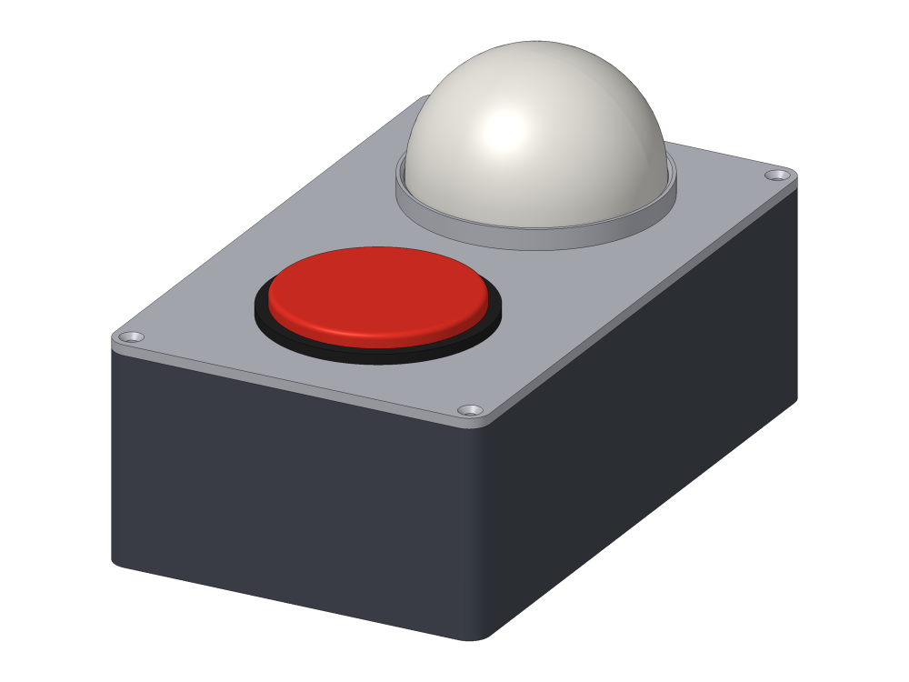

# ヤブイヌ式 早押しクイズボタン MK.1

ESP32 で作る **ワイヤレス早押しクイズボタン** です。
親機 1 台に子機を最大 64 台までつなげられます。Wi-Fi ルーターは不要です。

| 子機 | 親機 |
| :---: | :---: |
|  |  |

## 特徴

- **ワイヤレス**: ESP-NOW (ESP32 同士の直接通信) を使うので、配線もルーターも不要
- **充電式**: 18650 電池 + Type-C 充電 + 電源ボタン。子機は電池 1 本で約 9〜11 時間、親機は電池 3 本で約 25〜30 時間 (計算値)。
  電池残量も表示します
- **ボタンが光って状態を知らせる**: 子機は今押せるときだけ、親機は判定待ちのときにボタンが光ります
- **公平な判定**: 電波が届いた順ではなく「ボタンを押した瞬間の時刻」で判定 ([仕組み](docs/protocol.md))
- **汎用部品だけ**: ESP32 開発ボード / 60mm アーケードボタン / WS2812B LED / 乳白の半球カバー / DFPlayer Mini / TM1637 4 桁表示
- **3D プリント用データつき**: STL (そのまま印刷) と STEP (CAD で編集)、寸法を変えられる Python スクリプト
- **効果音つき**: 正解「ピンポーン」・不正解「ブッブー」・回答権「ピコーン」を同梱 (自作音源なので自由に使えます)
- **子機ごとの設定は不要**: 全子機に同じファームウェアを書き込むだけ。番号は親機が自動で割り振ります
- **パソコンと連携できる (使う人だけ)**: 受信機 (ESP32-C3 SuperMini 1 個) を USB でつなぐと、だれが回答中か・正解か不正解かを
  パソコンでリアルタイムに受け取れます ([PC 連携](docs/pc-link.md))

## 動き方

1. 子機のボタンを押す → **一番早く押した子機だけ**ランプが点灯 (ピコーン)。ほかの子機は押しても反応しません
2. 親機で判定ボタンを押す
   - **正解** (右の赤いボタン) → ピンポーン + 中央のランプが**赤**
   - **不正解** (左の青いボタン) → ブッブー + 中央のランプが**青**
3. どちらを押しても状態がリセットされ、次の早押しを受け付けます
   (回答者がいないときに押しても、音とランプが出てリセットされます。効果音ボタンとしても使えます)

### ランプと表示

| 場所 | 表示 | 意味 |
| --- | --- | --- |
| 子機ランプ | オレンジ点灯 (最初に 3 回点滅) | 回答権を獲得 |
| | 赤で点滅 (約 1 秒) | 自分の回答が正解だった |
| | 青で点滅 (約 1 秒) | 自分の回答が不正解だった |
| | 暗い青で 1.5 秒ごとに短く点滅 | 親機が見つからない (電源・距離を確認) |
| | 紫でゆっくり明滅 / 白く点灯 | 番号登録モード: 未登録 / 登録済み |
| | 電源を入れたとき 緑 / 黄 / 赤 | 電池残量: 半分以上 / 少なめ / 要充電 |
| | 4 秒ごとに暗い赤で短く光る | 電池残量わずか (充電してください) |
| | 赤く 3 回光って消える | 電池切れ寸前で休止した (充電してから電源を入れ直す) |
| 子機のボタン | 光っている | **今押せる** (受付中で、このラウンドではまだ押していない / 番号登録モードでまだ登録していない) |
| | 消えている | 押せない (ほかの人や自分が回答中・このラウンドで押した後・親機につながっていない) |
| 親機ランプ (中央) | 赤 | 正解 (5 秒間) |
| | 青 | 不正解 (5 秒間) |
| | 紫でゆっくり明滅 | 番号登録モード |
| | 4 秒ごとに暗い赤で短く光る | 親機の電池残量わずか |
| 親機の正解・不正解ボタン | 光っている | **判定待ち** (回答者が決まった。どちらかを押してください) |
| | 点滅 | 番号登録モード中 (押すと終了) |
| 親機の 4 桁表示 | `c 12` | 接続中の子機が 12 台 |
| | `  12` | 12 番の子機が回答権を獲得 |
| | `P  5` | 番号登録モード (次に押した子機が 5 番になる) |
| | `b 87` | 親機の電池残量 87% (起動時と、残量わずかのとき) |
| | `L  7` | 7 番の子機の電池残量がわずか (待機中に `c 12` と交互に表示) |

## 必要なもの

詳しくは [部品表](docs/bom.md) を、商品ページへのリンクと必要数は [買い物リスト](docs/shopping-list.md) を見てください。

| | 子機 (1 台あたり) | 親機 |
| --- | --- | --- |
| マイコン | ESP32-C3 SuperMini | ESP32 開発ボード (ESP32-DevKitC など) |
| ボタン | 60mm 押しボタン (12V LED 付き) x1 | 同じボタン x2 (左: 不正解の青 / 右: 正解の赤) |
| ランプ | WS2812B 7 連 LED 丸型基板 + 半球カバー (直径 68mm) x1 | 同じもの x1 (中央。正解で赤、不正解で青に光る) |
| 音 | — | DFPlayer Mini + microSD + スピーカー |
| 表示 | — | TM1637 4 桁 7 セグモジュール (0.36 インチ) |
| 電源 | 18650 x1 (1 本用の並列電池ボックス) + TP4056 Type-C 充電モジュール + MT3608 x2 (5V 用・ボタン LED の 12V 用) + 電源ボタン (Pten 16mm) | 18650 **x3** (3 本用の並列電池ボックス) + TP4056 + MT3608 x2 + 電源ボタン (**LA16 16mm, 5A**) |
| 充電 | USB 充電器 + Type-C ケーブル | 同じ |
| 中継基板 | 専用の基板 (子機用) x1。基板メーカーに注文する | 専用の基板 (親機用) x1 |
| ケース | 3D プリント 2 パーツ (箱・天板) | 3D プリント 2 パーツ (箱・天板) |

## 作り方

1. **ケースを印刷する** → [組み立て手順](docs/assembly.md)
   `hardware/stl/` の STL をそのままスライサーに入れれば印刷できます (サポート不要)
2. **ファームウェアを書き込む** (下記)
   配線の前に、マイコンだけを USB でパソコンにつないで書き込んでおくと、配線の途中で動きを確かめられます
3. **配線する (はんだ付け)** → [はんだ付けマニュアル](docs/soldering-guide.md)
   線 1 本ずつ番号を付けた図と手順書です (印刷用の [PDF 版](docs/soldering-guide.pdf) もあります)。回路の説明は [配線図](docs/wiring.md) にあります。
   抵抗などをまとめる「中継基板」は、専用の基板を基板メーカーに注文して使います ([中継基板を注文する](docs/pcb-order.md))。
   届くまで 1〜2 週間かかるので、早めに注文してください
4. **microSD に効果音を入れる** → `sounds/sd/` の中身 (`mp3` フォルダごと) を microSD のルートにコピー
5. 電源を入れて遊ぶ

### ファームウェアの書き込み

[PlatformIO](https://platformio.org/) を使います。VS Code の PlatformIO 拡張機能でも、コマンドラインでも書き込めます。

```bash
cd firmware
pio run -e master -t upload     # 親機 (ESP32 DevKit)
pio run -e child -t upload      # 子機 (ESP32-C3 SuperMini)
pio run -e receiver -t upload   # PC 連携の受信機 (使う人だけ。docs/pc-link.md)
```

子機は全台に同じファームウェアを書き込めば OK です。個別の設定はありません。

- 書き込むときは **電源ボタンを OFF** にしてから、開発ボードに USB ケーブルをつないでください
- SuperMini が書き込めないときは、基板の **BOOT ボタンを押したまま USB を挿し**、離してから書き込んでください
シリアルモニタ (`pio device monitor`) を開くと、誰が何 ms で押したかなどのログが見られます。

## 使い方

- 親機と子機の電源を入れる順番は自由です。子機は自動で親機を見つけます
- 子機の番号は、親機に初めてつながった順に自動で割り振られ、親機に保存されます

### 電源と充電

- **電源ボタン** を押すと ON、もう一度押すと OFF です
- **充電** は **電源ボタンを OFF にして** Type-C ケーブルをつなぎます。子機は約 3〜4 時間、親機 (電池 3 本) は約 10 時間なので一晩かけて充電してください
- 電源を入れたときの子機ランプの色 (緑 / 黄 / 赤) と、親機の `b 87` 表示で残量がわかります
- 残量が少なくなると、子機は 4 秒ごとに赤く短く光り、親機の表示にその子機の番号 (`L  7`) が出ます
- 電池が切れる寸前 (3.2V) になると、電池を守るために赤く 3 回光って休止します。充電してから電源を入れ直してください
- 子機の充電は、多ポートの USB 充電器を使うとまとめてできて便利です

### 番号を振り直す (番号登録モード)

子機に好きな順番で番号を付けたいときに使います。

1. 親機の **正解ボタンを押したまま電源を入れ**、1.5 秒そのまま押し続ける
2. 親機ランプが紫に明滅し、表示が `P  1` になる
3. **1 番にしたい子機から順にボタンを押す** (押した子機は白く 2 回光り、白く点灯したままになる)
4. 終わったら親機の正解 / 不正解ボタンのどちらかを押すと通常モードに戻る

登録モードで押さなかった子機には、通常モードに戻ったあと次の番号 (登録済みの台数 + 1) が自動で付きます。

## 設定

`firmware/include/config.h` で変更できます。よく使うものは次のとおりです。

| 設定 | 初期値 | 内容 |
| --- | --- | --- |
| `WIFI_CHANNEL` | 1 | 無線のチャンネル。親機と子機で同じにする |
| `GROUP_ID` | 1 | 同じ部屋で 2 セット以上使うときにセットごとに変える |
| `MAX_CHILDREN` | 64 | 子機の最大台数 |
| `JUDGE_LAMP_MS` | 5000 | 判定ランプの点灯時間。0 なら次の早押しまで点灯 |
| `WINNER_COLOR` | `0xFF7800` | 子機の回答ランプの色 |
| `CORRECT_COLOR` / `INCORRECT_COLOR` | `0xFF0000` / `0x0050FF` | 判定の色 (親機のランプと、判定された子機の点滅) |
| `LAMP_BRIGHTNESS` | 255 | ランプの明るさ (0〜255) |
| `AUDIO_VOLUME` | 24 | 音量 (0〜30) |
| `MASTER_LAMP_LEDS` / `CHILD_LAMP_LEDS` | 7 | ランプの LED 数 (7 連基板) |
| `BATTERY_LOW_MV` | 3450 | これより低いと「残量わずか」(mV) |
| `BATTERY_DIVIDER` | 2.0 | 電池電圧の分圧比。表示がずれるときに微調整 |
| `BATTERY_CUTOFF_MV` | 3200 | これを 10 秒下回ると電池を守るために休止 (mV) |
| `WIFI_TX_POWER` | (最大) | 無線の送信出力。子機の通信が不安定なときに `WIFI_POWER_8_5dBm` などに下げる (platformio.ini の `build_flags` に `-DWIFI_TX_POWER=WIFI_POWER_8_5dBm`) |
| `ARBITRATION_WINDOW_MS` | 50 | 最初の押下から判定までの待ち時間 |

ピン番号も同じファイルで変更できます。ケースの寸法は `hardware/enclosure/enclosure.py` の `Params` で変更します。

## ディレクトリ構成

```
firmware/                PlatformIO プロジェクト
  include/config.h       ピン配置・設定
  include/protocol.h     通信パケットの定義
  lib/buzzer_core/       判定ロジック (PC でテスト可能)
  src/master/            親機
  src/child/             子機
  src/receiver/          PC 連携の受信機
  src/common/            共通 (無線・LED・電池)
  test/                  ユニットテスト (pio test -e native)
hardware/
  stl/                   3D プリント用 STL
  step/                  CAD 用 STEP
  enclosure/             ケースを生成する Python スクリプト (build123d)
  wiring/                はんだ付けマニュアルの図・表・PDF を作る Python スクリプト
  pcb/                   中継基板のプリント基板 (注文用のデータ) と、それを作る Python スクリプト
pc/
  monitor.html           パソコンで状態を見るページ (PC 連携)
sounds/
  sd/mp3/                microSD にコピーする効果音
  generate_sounds.py     効果音を合成するスクリプト
docs/                    部品表・買い物リスト・配線図・はんだ付けマニュアル・基板の注文・組み立て・通信の仕組み・PC 連携
```

## 開発

```bash
# 判定ロジックのテスト (PC 上で実行)
cd firmware && pio test -e native

# ケースの再生成 (Python 3.10 以上)
pip install build123d
python hardware/enclosure/enclosure.py
python hardware/enclosure/render_preview.py   # プレビュー画像 (要 matplotlib)

# 効果音の再生成 (要 ffmpeg)
python sounds/generate_sounds.py
```

## ライセンス

[MIT License](LICENSE) — ファームウェア・3D データ・効果音のすべてが対象です。

---

## English summary

A wireless quiz buzzer system built on ESP32 and ESP-NOW. One master unit supports up to 64 buzzer units, with no Wi-Fi router needed.
Only the first buzzer pressed lights up. Others are locked out until the host presses *correct* or *incorrect* on the master, which plays a sound, lights the central lamp red (correct) or blue (incorrect), and resets the round.
Fairness is based on press timestamps synchronised to the master clock, not on radio arrival order.
Uses generic parts (ESP32 dev board, 60 mm arcade buttons, WS2812B 7-LED boards under 68 mm diffuser covers, DFPlayer Mini, TM1637 4-digit display) and includes 3D-printable enclosures (STL/STEP plus a parametric build123d script).
Both units run on rechargeable 18650 cells (1 in each buzzer, 3 in parallel in the master) with USB Type-C charging (TP4056), an MT3608 boost converter, a latching power button and battery-level indication.
Optionally, a spare ESP32-C3 plugged into a PC listens to the master and streams the game state (who buzzed in, correct / incorrect) as JSON lines over USB ([docs/pc-link.md](docs/pc-link.md), not yet tested on hardware).
