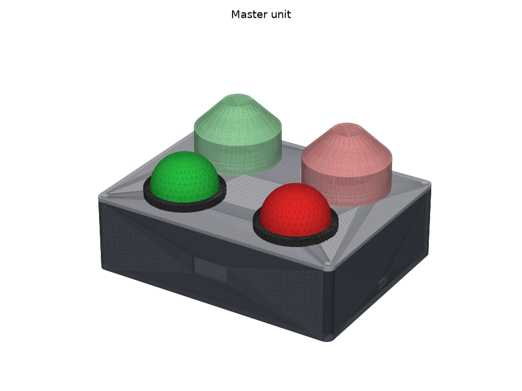

# 早押しボタン (Hayaoshi Buzzer)

ESP32 で作る **ワイヤレス早押しクイズボタン** です。
親機 1 台に子機を最大 64 台までつなげられます。Wi-Fi ルーターは不要です。

| 子機 | 親機 |
| :---: | :---: |
|  |  |

## 特徴

- **ワイヤレス**: ESP-NOW (ESP32 同士の直接通信) を使うので、配線もルーターも不要
- **公平な判定**: 電波が届いた順ではなく「ボタンを押した瞬間の時刻」で判定 ([仕組み](docs/protocol.md))
- **汎用部品だけ**: ESP32 開発ボード / 60mm アーケードボタン / WS2812B LED リング / DFPlayer Mini
- **3D プリント用データつき**: STL (そのまま印刷) と STEP (CAD で編集)、寸法を変えられる Python スクリプト
- **効果音つき**: 正解「ピンポーン」・不正解「ブッブー」・回答権「ピコーン」を同梱 (自作音源なので自由に使えます)
- **子機ごとの設定は不要**: 全子機に同じファームウェアを書き込むだけ。番号は親機が自動で割り振ります

## 動き方

1. 子機のボタンを押す → **一番早く押した子機だけ**ランプが点灯 (ピコーン)。ほかの子機は押しても反応しません
2. 親機で判定ボタンを押す
   - **正解** → ピンポーン + 緑ランプ
   - **不正解** → ブッブー + 赤ランプ
3. どちらを押しても状態がリセットされ、次の早押しを受け付けます
   (回答者がいないときに押しても、音とランプが出てリセットされます。効果音ボタンとしても使えます)

### ランプと表示

| 場所 | 表示 | 意味 |
| --- | --- | --- |
| 子機ランプ | オレンジ点灯 (最初に 3 回点滅) | 回答権を獲得 |
| | 緑で点滅 | 自分の回答が正解だった |
| | 赤で点滅 | 自分の回答が不正解だった |
| | 青く短く点滅 | 親機が見つからない (電源・距離を確認) |
| | 紫でゆっくり明滅 / 白く点灯 | 番号登録モード: 未登録 / 登録済み |
| 親機ランプ | 緑 | 正解 (3 秒間) |
| | 赤 | 不正解 (3 秒間) |
| 親機の 4 桁表示 | `c 12` | 接続中の子機が 12 台 |
| | `  12` | 12 番の子機が回答権を獲得 |
| | `P  5` | 番号登録モード (次に押した子機が 5 番になる) |

## 必要なもの

詳しくは [部品表](docs/bom.md) を見てください。

| | 子機 (1 台あたり) | 親機 |
| --- | --- | --- |
| マイコン | ESP32 開発ボード (または ESP32-C3 SuperMini) | ESP32 開発ボード |
| ボタン | 60mm アーケードボタン x1 | 60mm アーケードボタン x2 (緑・赤) |
| ランプ | WS2812B 16 連 LED リング x1 | WS2812B 16 連 LED リング x2 |
| 音 | — | DFPlayer Mini + microSD + スピーカー |
| 表示 (任意) | — | TM1637 4 桁 7 セグモジュール |
| 電源 | USB 充電器 / モバイルバッテリー | USB 充電器 (5V 2A) |
| ケース | 3D プリント 3 パーツ | 3D プリント 4 パーツ |

## 作り方

1. **ケースを印刷する** → [組み立て手順](docs/assembly.md)
   `hardware/stl/` の STL をそのままスライサーに入れれば印刷できます (サポート不要)
2. **配線する** → [配線図](docs/wiring.md)
3. **ファームウェアを書き込む** (下記)
4. **microSD に効果音を入れる** → `sounds/sd/` の中身 (`mp3` フォルダごと) を microSD のルートにコピー
5. 電源を入れて遊ぶ

### ファームウェアの書き込み

[PlatformIO](https://platformio.org/) を使います。VS Code の PlatformIO 拡張機能でも、コマンドラインでも書き込めます。

```bash
cd firmware
pio run -e master -t upload     # 親機
pio run -e child -t upload      # 子機 (ESP32)
pio run -e child_c3 -t upload   # 子機 (ESP32-C3 SuperMini を使う場合)
```

子機は全台に同じファームウェアを書き込めば OK です。個別の設定はありません。
シリアルモニタ (`pio device monitor`) を開くと、誰が何 ms で押したかなどのログが見られます。

## 使い方

- 親機と子機の電源を入れる順番は自由です。子機は自動で親機を見つけます
- 子機の番号は、親機に初めてつながった順に自動で割り振られ、親機に保存されます

### 番号を振り直す (番号登録モード)

子機に好きな順番で番号を付けたいときに使います。

1. 親機の **正解ボタンを押したまま電源を入れ**、1.5 秒そのまま押し続ける
2. 親機ランプが紫に明滅し、表示が `P  1` になる
3. **1 番にしたい子機から順にボタンを押す** (押した子機は白く 2 回光り、白く点灯したままになる)
4. 終わったら親機の正解 / 不正解ボタンのどちらかを押すと通常モードに戻る

登録モードで押さなかった子機には、通常モードに戻ったあと空いている番号が自動で付きます。

## 設定

`firmware/include/config.h` で変更できます。よく使うものは次のとおりです。

| 設定 | 初期値 | 内容 |
| --- | --- | --- |
| `WIFI_CHANNEL` | 1 | 無線のチャンネル。親機と子機で同じにする |
| `GROUP_ID` | 1 | 同じ部屋で 2 セット以上使うときにセットごとに変える |
| `MAX_CHILDREN` | 64 | 子機の最大台数 |
| `JUDGE_LAMP_MS` | 3000 | 判定ランプの点灯時間。0 なら次の早押しまで点灯 |
| `WINNER_COLOR` | `0xFF7800` | 子機の回答ランプの色 |
| `LAMP_BRIGHTNESS` | 160 | ランプの明るさ (0〜255) |
| `AUDIO_VOLUME` | 24 | 音量 (0〜30) |
| `USE_DISPLAY` | 1 | 4 桁表示を使わないなら 0 |
| `MASTER_LEDS_PER_LAMP` / `CHILD_LAMP_LEDS` | 16 | LED リングの LED 数 |
| `ARBITRATION_WINDOW_MS` | 50 | 最初の押下から判定までの待ち時間 |

ピン番号も同じファイルで変更できます。ケースの寸法は `hardware/enclosure/enclosure.py` の `Params` で変更します。

## ディレクトリ構成

```
firmware/                PlatformIO プロジェクト
  include/config.h       ピン配置・設定
  include/protocol.h     通信パケットの定義
  lib/buzzer_core/       判定ロジック (PC でテスト可能)
  src/master/            親機
  src/child/             子機
  src/common/            共通 (無線・LED)
  test/                  ユニットテスト (pio test -e native)
hardware/
  stl/                   3D プリント用 STL
  step/                  CAD 用 STEP
  enclosure/             ケースを生成する Python スクリプト (build123d)
sounds/
  sd/mp3/                microSD にコピーする効果音
  generate_sounds.py     効果音を合成するスクリプト
docs/                    部品表・配線図・組み立て・通信の仕組み
```

## 開発

```bash
# 判定ロジックのテスト (PC 上で実行)
cd firmware && pio test -e native

# ケースの再生成 (Python 3.10 以上)
pip install build123d
python hardware/enclosure/enclosure.py
python hardware/enclosure/render_preview.py   # プレビュー画像 (要 matplotlib)

# 効果音の再生成 (要 ffmpeg)
python sounds/generate_sounds.py
```

## ライセンス

[MIT License](LICENSE) — ファームウェア・3D データ・効果音のすべてが対象です。

---

## English summary

A wireless quiz buzzer system built on ESP32 and ESP-NOW. One master unit supports up to 64 buzzer units, with no Wi-Fi router needed.
Only the first buzzer pressed lights up. Others are locked out until the host presses *correct* or *incorrect* on the master, which plays a sound, lights the green or red lamp, and resets the round.
Fairness is based on press timestamps synchronised to the master clock, not on radio arrival order.
Uses generic parts (ESP32 dev board, 60 mm arcade buttons, WS2812B rings, DFPlayer Mini) and includes 3D-printable enclosures (STL/STEP plus a parametric build123d script).
