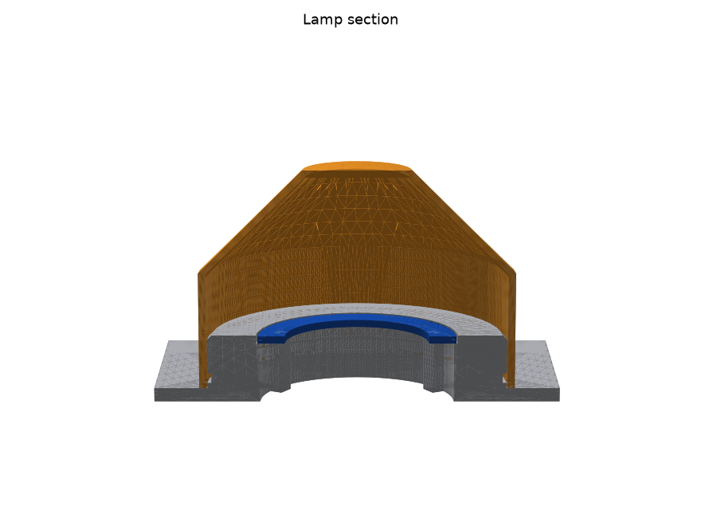

# 3D プリントと組み立て

## 印刷するパーツ

| ファイル | 子機 1 台 | 親機 | 大きさ (mm) | 色の例 |
| --- | :---: | :---: | --- | --- |
| `hardware/stl/child_base.stl` | 1 | | 110 x 180 x 60 | 好きな色 |
| `hardware/stl/child_top.stl` | 1 | | 110 x 180 x 15 | 好きな色 |
| `hardware/stl/master_base.stl` | | 1 | 210 x 160 x 60 | 好きな色 |
| `hardware/stl/master_top.stl` | | 1 | 210 x 160 x 15 | 好きな色 |
| `hardware/stl/lamp_dome.stl` | 1 | 2 | 70 x 70 x 49 | **白 / 半透明** |

親機は 220 x 220mm 以上の造形エリア (Ender-3 クラス以上) が必要です。子機は 180mm 以上あれば印刷できます。



### おすすめの印刷設定

| | 箱・天板 | ドーム |
| --- | --- | --- |
| 素材 | PLA / PETG | **白か半透明 (natural) の** PLA / PETG |
| 積層ピッチ | 0.2mm | 0.2mm |
| 壁 (ペリメーター) | 3 周 | 4 周 (= 厚さ 1.6mm を全部壁で埋める) |
| インフィル | 15〜20% | 0% (壁だけになる) |
| サポート | 不要 | 不要 |
| 向き | STL のまま (箱は底面が下、天板は平らな面が下) | STL のまま (開いている側が下) |

ドームを白や半透明で印刷すると、中の LED の光がきれいに拡散します。

## 寸法を変えたいとき

`hardware/enclosure/enclosure.py` の `Params` を書き換えて実行すると、STL と STEP が作り直されます。

```bash
pip install build123d
python hardware/enclosure/enclosure.py
```

| 変えたいこと | パラメータ |
| --- | --- |
| ボタンの取付穴 | `button_hole_d` (初期値 24.5mm) |
| LED リングの大きさ | `ring_od` (初期値 44mm) |
| ドームのはめあいがきつい / ゆるい | `fit` (初期値 0.2mm。きつければ大きく) |
| ドームの大きさ・高さ | `dome_od` / `dome_cyl_h` |
| 箱の大きさ | `CHILD_SIZE` / `MASTER_SIZE` |
| 部品の位置 | `CHILD_BUTTON` / `CHILD_LAMP` / `MASTER_BUTTONS` / `MASTER_LAMPS` |

STEP ファイル (`hardware/step/`) は Fusion / FreeCAD / Onshape などで開いて直接編集することもできます。

## 組み立て (子機)

1. **ボタンを天板に取り付ける**: 天板の穴にアーケードボタンを差し込み、裏からナットで締める
2. **LED リングに配線する**: リングの裏の `DIN` `5V` `GND` に電線をはんだ付けする (20cm くらい)
3. **LED リングを置く**: 天板のドーム受け (丸い台) の上のくぼみに、LED を上にして置く。
   電線は中央の穴から天板の裏へ通す。ずれるならホットボンドで数か所留める
4. **ドームをかぶせる**: ドーム受けにドームを押し込むと、内側の爪が溝にはまって固定される
5. **開発ボードを固定する**: 箱の底に厚手の両面テープで貼る。
   ピンヘッダ付きのボードは **裏返して (ピンを上に向けて)** 貼るとジャンパーワイヤ (メス) で配線できる
6. **配線する**: [配線図](wiring.md) のとおり。USB ケーブルは背面の穴から通して開発ボードに挿す
7. **ファームウェアを書き込んで動作確認** してから、天板を M3 皿タッピングビス 4 本で留める

## 組み立て (親機)

子機と同じ手順に加えて:

- **向き**: ボタンが手前 (司会者側)、ランプが奥 (観客側) です。左が正解 (緑)、右が不正解 (赤)
- **4 桁表示**: 手前の壁の四角い窓に、内側から表示モジュールを当ててホットボンドか両面テープで固定
- **スピーカー**: 奥の壁のスリットの内側に、ホットボンドで周囲を留める
- **DFPlayer**: microSD を挿してから箱の中に両面テープで固定
- **USB ケーブル**: 右側の壁の穴から通す
- **LED リング**: 左 (緑ランプ) のリングに ESP32 からのデータ線をつなぎ、その `DOUT` から右 (赤ランプ) のリングの `DIN` へつなぐ

## 動作確認の順番

1. 親機だけ電源を入れる → 緑・赤のランプが順に光り、起動音が鳴り、表示が `c  0` になる
2. 子機の電源を入れる → ランプが一瞬オレンジに光る → 親機の表示が `c  1` になる
3. 子機のボタンを押す → 子機のランプがオレンジに点灯、親機から「ピコーン」、表示に子機の番号
4. 親機の正解ボタン → 「ピンポーン」、緑ランプ、子機のランプが緑に点滅して消える
