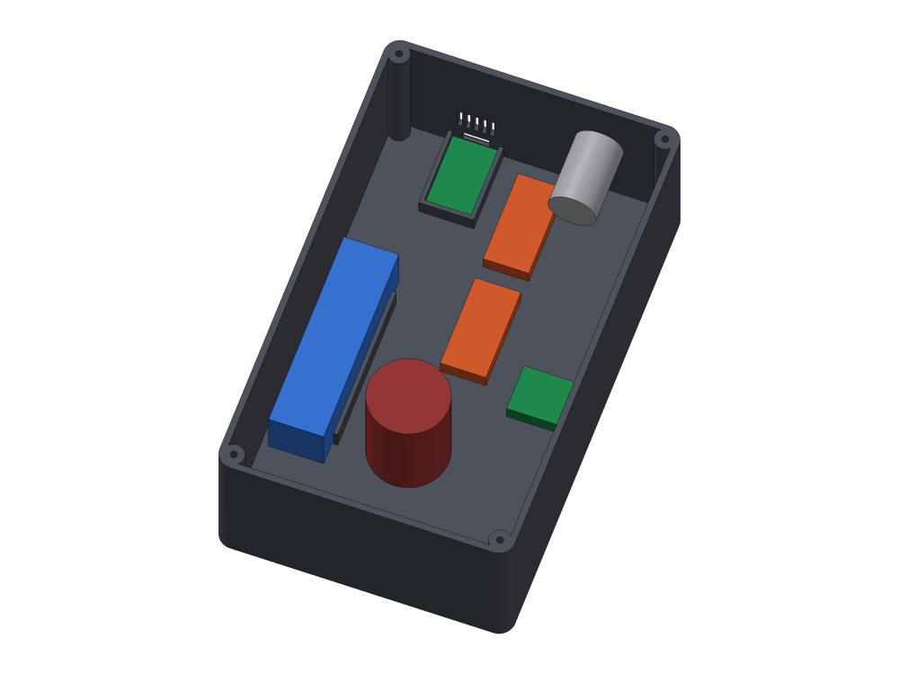
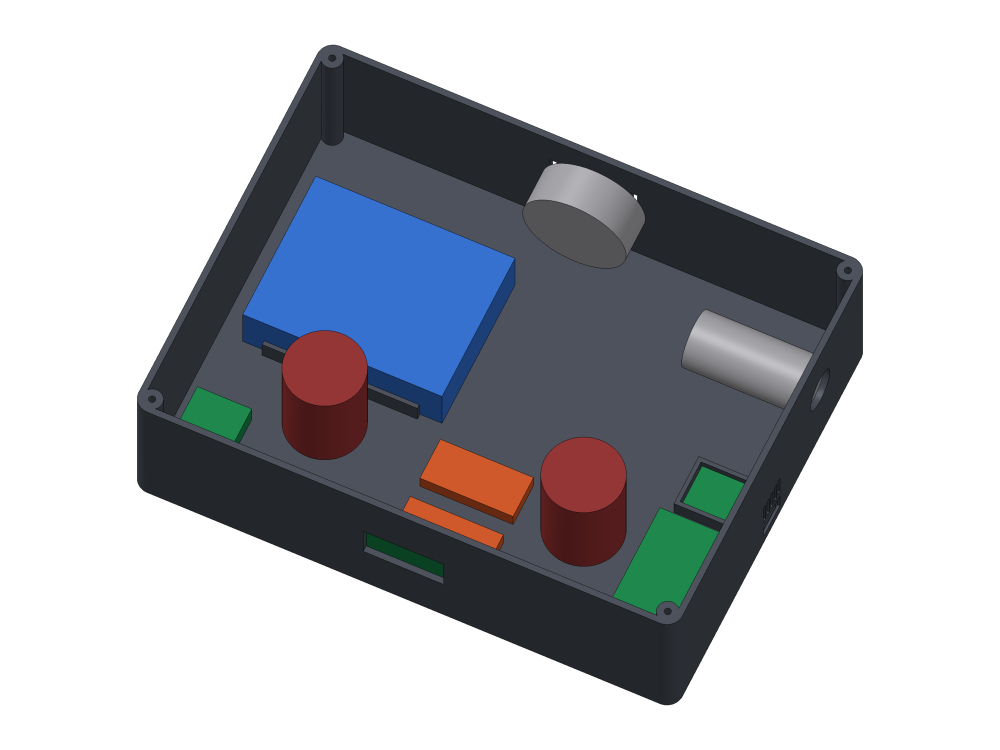

# 3D プリントと組み立て

## 印刷するパーツ

| ファイル | 子機 1 台 | 親機 | 大きさ (mm) | 色の例 |
| --- | :---: | :---: | --- | --- |
| `hardware/stl/child_base.stl` | 1 | | 110 x 180 x 60 | 好きな色 |
| `hardware/stl/child_top.stl` | 1 | | 110 x 180 x 9 | 好きな色 |
| `hardware/stl/master_base.stl` | | 1 | 210 x 160 x 60 | 好きな色 |
| `hardware/stl/master_top.stl` | | 1 | 210 x 160 x 9 | 好きな色 |
| `hardware/stl/lamp_dome.stl` (任意) | (1) | (1) | 68 x 68 x 38 | **白 / 半透明** |

ランプのカバーは購入品の半球カバー (直径 68mm) を使います ([部品表](bom.md#ランプ-led-基板--半球カバー))。
`lamp_dome.stl` は、カバーが手に入らないときに代わりに印刷するドームです (同じ受けに入ります)。

`child_base` / `master_base` には、電池ボックスのレール・充電モジュールの台・Type-C の穴・電源ボタンの穴・充電モジュール用の通気穴がついています。
**箱と天板は PETG で印刷してください** (充電中に充電モジュールが熱くなるため。PLA は 55〜60℃ で柔らかくなります)。

### 中の配置

| 子機 | 親機 |
| :---: | :---: |
|  |  |

青: 18650 電池ボックス (子機は 1 本用、親機は 3 本用の並列タイプ) / 緑: 基板 (子機は TP4056 と ESP32-C3 SuperMini、親機は TP4056・ESP32・DFPlayer・4 桁表示) / 銀: 電源ボタンとスピーカー / オレンジ: MT3608 (5V 用と 12V 用の 2 個) / 赤: アーケードボタンの胴体

- **子機**: 電池は左の壁沿い。背面に Type-C 充電口 (左寄り) と電源ボタン (右寄り)
- **親機**: 3 本用の電池ボックスは左奥 (ボタンの真下とスピーカーを避けた位置)。右の壁に Type-C 充電口 (中央) と電源ボタン (奥寄り)。
  ESP32 開発ボードは右手前に置きます

親機は 220 x 220mm 以上の造形エリア (Ender-3 クラス以上) が必要です。子機は 180mm 以上あれば印刷できます。


### おすすめの印刷設定

| | 箱・天板 | ドーム (任意) |
| --- | --- | --- |
| 素材 | **PETG** | **白か半透明 (natural) の** PLA / PETG |
| 積層ピッチ | 0.2mm | 0.2mm |
| 壁 (ペリメーター) | 3 周 | 4 周 (= 厚さ 1.6mm を全部壁で埋める) |
| インフィル | 15〜20% | 0% (壁だけになる) |
| サポート | 不要 | 不要 |
| 向き | STL のまま (箱は底面が下、天板は平らな面が下) | STL のまま (開いている側が下) |

ドームを白や半透明で印刷すると、中の LED の光がきれいに拡散します。

## 寸法を変えたいとき

`hardware/enclosure/enclosure.py` の `Params` を書き換えて実行すると、STL と STEP が作り直されます。

```bash
pip install build123d
python hardware/enclosure/enclosure.py
```

| 変えたいこと | パラメータ |
| --- | --- |
| ボタンの取付穴 | `button_hole_d` (初期値 24.0mm) |
| 半球カバーのふちの外径 | `cover_od` (初期値 68mm。届いたカバーを測って合わせる) |
| カバーと受けのはめあい | `fit` (初期値 0.3mm。入らなければ大きく、ゆるければ小さく) |
| LED 基板の大きさ | `led_board_d` (初期値 23mm) |
| LED の高さ (カバーの中での位置) | `pedestal_h` (初期値 4mm) |
| 箱の大きさ | `CHILD_SIZE` / `MASTER_SIZE` |
| 部品の位置 | `CHILD_BUTTON` / `CHILD_LAMP` / `MASTER_BUTTONS` / `MASTER_LAMPS` |
| 電池ボックスの幅 | `child_holder_w` (1 本用, 初期値 21mm) / `master_holder_w` (3 本用, 初期値 61mm) |
| 充電モジュールの大きさ | `charger_w` / `charger_l` (初期値 17.4 x 28mm) |
| Type-C の穴の高さ | `usbc_z` (コネクタの高さが合わないとき) |
| 電源ボタンの穴 | `power_button_d` (初期値 16.2mm) |
| 電池・充電口・電源ボタンの位置 | `CHILD_CELLS` / `CHILD_CHARGER_X` / `CHILD_POWER_X` / `MASTER_CELLS` など |

STEP ファイル (`hardware/step/`) は Fusion / FreeCAD / Onshape などで開いて直接編集することもできます。

## 組み立て (子機)

1. **ボタンを天板に取り付ける**: 天板の穴にアーケードボタンを差し込み、裏からナットで締める
2. **LED 基板に配線する**: 7 連基板の `IN` `PWR` `GND` に電線をはんだ付けする (20cm くらい)。パッドは LED 側の面にあるので、
   電線は基板の縁を回して裏へ出す。`OUT` は使わない
3. **LED 基板を置く**: ランプの受け (丸い枠) の中央にある台のくぼみに、LED を上にして置く。
   電線は台の中央の穴から天板の裏へ通す。ずれないようにホットボンドで数か所留める
4. **半球カバーを付ける**: 丸い受けにカバーのふちを差し込み、プラスチック用接着剤かホットボンドで固定する
   (先に動作確認をしてから固定すると、やり直しが楽)
5. **ESP32-C3 SuperMini を固定する**: 電線を直接はんだ付けしてから、箱の底の右側に厚手の両面テープで貼る
   - **アンテナの向き**: アンテナ (USB Type-C と反対側の端にある小さな部品) を **右の壁側** に向け、電池やほかの金属から離す
   - USB Type-C 端子は、天板を開けたときに挿せる向きにしておくと、あとで書き込み直すときに楽
6. **配線する**: [配線図](wiring.md) のとおり
7. **ファームウェアを書き込んで動作確認** してから、天板を M3 皿タッピングビス 4 本で留める

### 電源まわり (子機・親機共通)

1. **MT3608 の出力を合わせる**: 電池 (または 3.7〜5V の電源) を `VIN` につなぎ、テスターで `VOUT` を測りながら
   半固定抵抗を回す。**ほかの部品をつなぐ前に必ず行う**
   - 電源用: **5.1V**
   - ボタン LED 用 (2 個目): **12V**。取り違えないように、12V にした方に印を付けておく
2. **電源ボタンを取り付ける**: 背面 (親機は右側面) の丸穴に、外側から差し込んで内側からナットで締める
3. **TP4056 モジュールを置く**: 台の上に部品面を上にして載せ、Type-C コネクタを壁の穴に突き当てる。
   外から Type-C ケーブルがまっすぐ挿さるのを確認してから、ホットボンドで基板を固定する
   (コネクタの高さが合わない場合は、基板の下に薄い板を挟むか `usbc_z` を変えて印刷し直す)
4. **電池ボックスを置く**: レールの間に入れて、両面テープで固定する (並列タイプなので配線は赤 = +、黒 = − の 2 本だけ)
5. **MT3608 を置く**: 空いている場所に両面テープで固定する (5V 用と 12V 用の 2 個)
6. [配線図の「電源回路」](wiring.md#電源回路-親機子機共通) のとおりに配線する。
   さらに [「ボタン内蔵 LED (12V)」](wiring.md#ボタン内蔵-led-12v) の回路も配線する
7. **電源ボタンを OFF にして** 電池を入れ、Type-C で充電する (TP4056 の LED: 赤 = 充電中 / 青 = 満充電)
8. **底にゴム足を 4 個貼る** (充電モジュールの下の通気穴をふさがないように、箱を少し浮かせる)

## 組み立て (親機)

子機と同じ手順に加えて:

- **向き**: ボタンが手前 (司会者側)、ランプは奥 (観客側) の中央です。司会者から見て **左が不正解 (青)、右が正解 (赤)**
- **ESP32 開発ボード**: 右手前に置く。**アンテナ (基板の端のジグザグ模様の部分) を手前の壁側** に向け、上や周りに電池・スピーカーなどの金属が来ないようにする
- **4 桁表示**: 手前の壁の四角い窓に、内側から表示モジュールを当ててホットボンドか両面テープで固定
- **スピーカー**: 奥の壁のスリットの内側に、ホットボンドで周囲を留める
- **DFPlayer**: microSD を挿してから箱の中に両面テープで固定
- **電池**: 3 本用の **並列タイプ** の電池ボックスを使う。**入れる前に 3 本とも満充電して電圧をそろえる**
- **ボタンのマイクロスイッチの向き**: 正解・不正解ボタンのマイクロスイッチは **両方とも手前 (司会者側) に向ける**。
  奥に向けると電池ボックスに、外側に向けると ESP32 に当たることがあります
- **DFPlayer の電源**: DFPlayer の `VCC` は 5V ではなく電池の線 (電源ボタンの後ろ) につなぐ ([配線](wiring.md))
- **LED 基板**: 中央のランプの基板の `IN` に ESP32 からのデータ線をつなぐ (`OUT` は使わない)

## 動作確認の順番

1. 親機の電源ボタンを押す → 表示に電池残量 (`b 87` など) → 中央のランプが赤・青の順に光り、起動音が鳴り、表示が `c  0` になる
2. 子機の電源ボタンを押す → ランプが電池残量の色 (緑 / 黄 / 赤) で一瞬光る → 親機の表示が `c  1` になる
3. 子機のボタンを押す → 子機のランプがオレンジに点灯、親機から「ピコーン」、表示に子機の番号
4. 親機の正解ボタン (右の赤) → 「ピンポーン」、中央のランプが赤、子機のランプが赤く点滅して消える
5. もう一度子機のボタンを押してから、親機の不正解ボタン (左の青) → 「ブッブー」、中央のランプが青、子機のランプが青く点滅して消える
