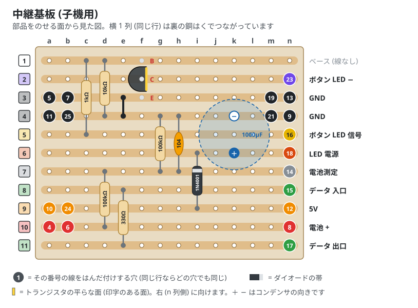
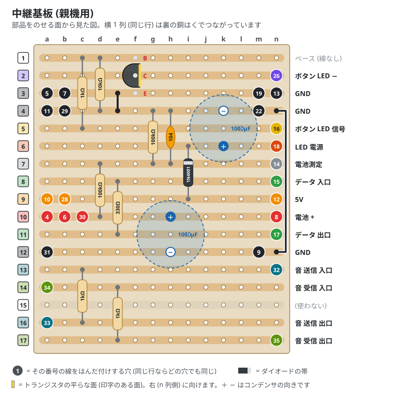

# 中継基板をストリップ基板で作る (注文しない場合)

[はんだ付けマニュアル](soldering-guide.md) は、基板メーカーに注文した中継基板を使う前提で書いてあります。
このページは、**注文せずに、市販のストリップ基板で同じ中継基板を手作りする方法** です。

- 回路・線の番号・行の番号は、注文した基板と同じです
- 作り終わったら、はんだ付けマニュアルの 4 章 (子機) / 5 章 (親機) からそのまま進められます
- マニュアルの表にある「4 番の穴」などは、このページの図で **同じ番号が書かれた色つきの丸** の穴です

| | 注文した基板 | ストリップ基板で手作り |
| --- | --- | --- |
| 作業 | 印刷のとおりに部品を挿す | 基板を切り、行の番号を書き、穴を数えて部品を挿す |
| 始められる時期 | 注文してから 1〜2 週間 | 基板があればすぐ |
| 大きさ (子機用 / 親機用) | 約 52 x 33mm / 約 53 x 48mm | 約 38 x 30mm / 約 38 x 46mm |

## 用意するもの

| もの | 量 | メモ |
| --- | --- | --- |
| ストリップ基板 (2.54mm ピッチ) | 子機 1 台につき 14 穴 x 11 行、親機は 14 穴 x 17 行 | 65 x 145mm のものなら、子機 8 台 + 親機 1 台分で 2〜3 枚 (帯が長い辺にそっていれば 2 枚、短い辺にそっていれば 3 枚) |
| 油性ペン | 1 | 基板に行の番号を書く |
| カッターと、やすり | | 基板を切る |

ストリップ基板は「ストリップボード」「stripboard」「veroboard」の名前で売っています。
**裏の銅はくが、端から端まで 1 本の帯になっている基板** を選んでください (商品名に uncut とあるもの)。
穴ごとに銅はくが分かれている普通のユニバーサル基板や、5 穴ずつつながったブレッドボード型の基板とは別物です。

- AliExpress の例: [6.5 x 14.5cm ストリップボード 5 枚入り](https://ja.aliexpress.com/item/32844204108.html)
  (2026 年 11 月の検索結果の表示で 177 円。商品ページのオプションと在庫は確認できていません)

## 基板を切る

1. ストリップ基板を、**銅はくの帯が横向き** になるように置く
2. 子機用は **14 穴 x 11 行** (約 38 x 30mm)、親機用は **14 穴 x 17 行** (約 38 x 46mm) の大きさに切る。
   **14 穴が帯の向き** (1 本の帯に穴が 14 個) になるようにする。
   切る位置の穴の列にカッターで両面から何度も筋を入れ、机の角に当てて折る (切った列の穴はなくなるので、1 列余分に数える)
3. 切り口をやすりで軽くこすり、となりの帯とつながる銅のくずを落とす
4. 部品をのせる面 (銅はくのない面) の左はしに、油性ペンで上から行の番号 1、2、3… を書く

## 部品をはんだ付けする

部品は **銅はくのない面** から足を挿し、裏の銅はくにはんだ付けして、余った足をニッパーで切ります。
下の表の順 (背の低い部品から) に付けると、基板を裏返したときに部品が落ちにくくなります。
ジャンパーは、先に付けた抵抗の足を切った残りで作ります (注文した基板にはない部品です)。

穴の場所は「列のアルファベット + 行の番号」で表します。たとえば `c5` は、左から 3 列目・上から 5 行目の穴です。

親機用は、子機用の下に 6 行足して、部品を 4 つ増やしたものです。1〜11 行の部品は子機用と同じです。

<!-- AUTO:strip-parts -->
| 順 | 部品 | 足を挿す穴 | 向き・注意 | 使う機種 |
| :---: | --- | --- | --- | :---: |
| 1 | 抵抗 1kΩ | `c1` と `c5` | 向きなし | 両方 |
| 2 | 抵抗 10kΩ | `d1` と `d4` | 向きなし | 両方 |
| 3 | 抵抗 100kΩ | `g4` と `g7` | 向きなし | 両方 |
| 4 | 抵抗 100kΩ | `d7` と `d10` | 向きなし | 両方 |
| 5 | 抵抗 330Ω | `e8` と `e11` | 向きなし | 両方 |
| 6 | 抵抗 1kΩ | `c13` と `c16` | 向きなし | 親機だけ |
| 7 | 抵抗 1kΩ | `e14` と `e17` | 向きなし | 親機だけ |
| 8 | ジャンパー (切り落とした抵抗の足で作る) | `e3` と `e4` | コの字に曲げて挿す | 両方 |
| 9 | ジャンパー線 (被覆つきの電線 約 4cm) | `n4` と `n12` | ほかの線のじゃまにならないよう基板の端を通す | 親機だけ |
| 10 | ダイオード 1N4001 | `i6` と `i9` | **帯のある側を 6 行へ** | 両方 |
| 11 | セラミックコンデンサ 0.1µF (印字 104) | `h4` と `h7` | 向きなし。足を少し広げて挿す | 両方 |
| 12 | トランジスタ 2SC1815 | `f1` (B) ・ `f2` (C) ・ `f3` (E) | **印字のある平らな面を右 (n 列側) へ**。足を広げて 3 つの穴に | 両方 |
| 13 | 電解コンデンサ 1000µF | `k4` と `k6` | **長い足 (＋) を 6 行、帯のある側 (−) を 4 行へ** | 両方 |
| 14 | 電解コンデンサ 1000µF | `h10` と `h12` | **長い足 (＋) を 10 行、帯のある側 (−) を 12 行へ** | 親機だけ |
<!-- /AUTO -->

- 抵抗とダイオードの足は、挿す 2 つの穴の間隔に合わせて直角に曲げます。穴が 3 つ分はなれている所 (7.6mm) は、**胴体のすぐ横** で曲げるとちょうど合います
- 図のトランジスタの **黄色い線が、印字のある平らな面** です。平らな面を右 (n 列側) に向けます
- 電解コンデンサは **直径 10mm 以下** のものを使います (10V 1000µF なら 8〜10mm)。大きくてとなりの部品に当たるときは、足を長めに残して少し倒してかまいません
- 向きのある部品の見分け方は、[はんだ付けマニュアルの 2 章](soldering-guide.md#向きのある部品) にあります

## 線をはんだ付けする穴

図の **色つきの丸** が、線をはんだ付けする穴です。丸の中の数字が線の番号で、はんだ付けマニュアルの表の「4 番の穴」は、`4` と書かれた丸の穴のことです。

同じ行の穴は裏の帯でつながっているので、**同じ行なら、空いているどの穴に挿しても同じ** です。

## 確認 (テスターの導通チェック)

テスターを導通チェック (つながっているとブザーが鳴る) にして、行のはんだ付けした所に当てます。

| 当てる所 | 正しい結果 |
| --- | --- |
| 3 行と 4 行 (親機用は 12 行も) | 鳴る |
| となり合う行どうし (1 と 2、2 と 3、4 と 5 … 順番に全部) | 鳴らない。鳴ったら、はんだがとなりの帯にはみ出している |
| 9 行 (5V) と 3 行 (GND) | 鳴らない |
| 10 行 (電池 +) と 3 行 (GND) | 鳴らない |

電解コンデンサのある行では、当てた瞬間だけ短く鳴ることがあります。すぐ止まれば正常です。

## 普通のユニバーサル基板を使う場合

穴ごとに銅はくが分かれている基板では、同じ行の穴がつながっていません。
部品を挿したあと、**行ごとに、使っている穴どうしを裏でつなぎます**。

- となりの穴なら、部品の足を切る前に横へ倒して、となりの足と一緒にはんだ付けする
- 離れた穴は、スズメッキ線 (直径 0.5mm くらいの裸の線) を行にそって置き、使っている穴ごとにはんだ付けする
- 線をはんだ付けする穴 (図の色つきの丸) まで、スズメッキ線をのばしておく

## ケースに入れるとき

ストリップ基板の裏は、銅はくの帯がむき出しです。金属やほかの基板にさわるとショートするので、
厚手の両面テープ (スポンジの入ったもの) かホットボンドで、底から浮かせて固定してください。
