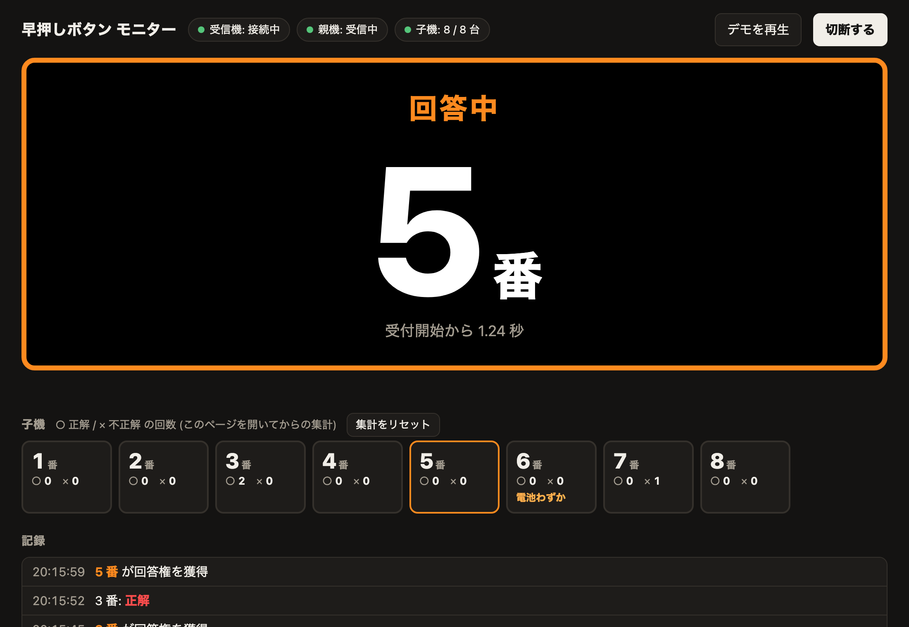

# パソコンとつなぐ (PC 連携)

「今だれが回答中か」「正解か不正解か」を、パソコンでリアルタイムに受け取る機能です。
配信画面に回答者を出す、得点を自動で数える、自分のプログラムと組み合わせる、といった使い方ができます。

使うかどうかは自由です。使わない場合、用意するものも作業もありません。

> **この機能は、まだ実機で動かしたことがありません。**
> 下の「確認していること」のとおり、ロジックのテストとビルドまでは確かめていますが、
> 本物の受信機と親機をつないだ動作は、部品が届いてから確かめる段階です。



## 仕組み


- 親機は、もともと「今の状態」を 0.1 秒ごとに無線で全体へ送っています (状態が変わったときは、すぐに 3 回続けて送ります)
- **受信機** は、その無線を聞いて、内容を USB からパソコンへ流します
- 受信機は聞くだけで、電波を出しません。受信機があってもなくても、早押しの動きは変わりません
- 親機と子機の配線やケースは、何も変えません

親機を USB でパソコンに直接つなぐ方法は使いません。親機のケースには USB 端子用の穴がなく、
電池の 5V とパソコンの USB の 5V がぶつかるためです ([配線図の注意](wiring.md))。

## 用意するもの

| もの | 数 | メモ |
| --- | ---: | --- |
| ESP32-C3 SuperMini | 1 | 子機と同じ基板。**配線もはんだ付けもしません** (ピンも付けなくてよい) |
| USB Type-C ケーブル | 1 | **データ通信ができるもの** (充電専用のケーブルは使えません) |
| パソコン | 1 | Chrome か Edge が入っているもの |

## 準備

1. **受信機にファームウェアを書き込む**。SuperMini を USB でパソコンにつないで、次を実行します

   ```bash
   cd firmware
   pio run -e receiver -t upload
   ```

2. **親機には、バージョン 1.1 以降のファームウェアを書き込む** ([書き込み方](../README.md#ファームウェアの書き込み))。
   子機の接続台数や電池の情報は、1.1 以降の親機だけが送ります。子機は書き込み直さなくても動きます

`WIFI_CHANNEL` と `GROUP_ID` ([設定](../README.md#設定)) を変えている場合は、受信機も同じ設定で書き込んでください
(同じ `config.h` を使うので、同じフォルダで書き込めば同じになります)。

## 使い方

1. 受信機を USB でパソコンにつなぐ
2. [`pc/monitor.html`](../pc/monitor.html) を Chrome か Edge で開く (ファイルをブラウザーにドラッグするか、ダブルクリック)
3. 右上の **「受信機につなぐ」** を押して、受信機のポートを選ぶ
   (`USB JTAG/serial debug unit` のような名前で出ます)
4. 親機の電源を入れる。「親機: 受信中」になれば準備完了です

| 表示 | 意味 |
| --- | --- |
| 受付中 | 子機のボタンを待っている |
| 回答中 + 番号 (オレンジ) | その番号の子機が回答権を取った。下に、受付開始から押すまでの時間が出る |
| 正解 (赤) / 不正解 (青) + 番号 | 親機で判定ボタンが押された。5 秒たつと「受付中」に戻る |
| 親機を探しています | 親機の電波が届いていない |

- 「子機」の所には、子機ごとの正解・不正解の回数が出ます (ページを開いてからの集計。閉じると消えます)
- **「デモを再生」** を押すと、受信機がなくても見本のデータで画面の動きを見られます
- 一度つないだ受信機は、次にページを開いたときに自動でつながります
- 受信機の基板の LED は、**点灯 = 親機の電波を受信中**、**点滅 = 親機を探している** です

ファイルを直接開いて「受信機につなぐ」が使えないときは、次のようにして開いてください。

```bash
cd pc
python3 -m http.server 8000
```

そのあと、ブラウザーで `http://localhost:8000/monitor.html` を開きます。

## 受け取れる情報

| 情報 | 届く行 (`type`) |
| --- | --- |
| 受付中か、回答者が決まったか、番号登録モードか | `state` / `open` / `buzz` / `register` |
| 回答中の子機の番号 | `buzz` / `state` |
| 正解か不正解か、判定された子機の番号 | `judge` |
| ラウンド番号 (判定のたびに 1 増える) | `buzz` / `judge` / `open` / `state` |
| 親機の電波が届いているか | `master` / `state` |
| 子機の登録台数、接続中の台数と番号 | `info` |
| 電池残量がわずかな子機の番号、親機の電池電圧 | `info` |
| 受付開始から回答者がボタンを押すまでの時間、ほぼ同時に押した台数 | `info` |

受け取れないもの:

- **2 番目以降に押した人の番号と時間差**。子機は、回答者が決まったあとは押したことを送らないためです
- 子機ごとの電池電圧の数値 (「わずか」かどうかだけ分かります)

状態が変わってからパソコンに届くまでの遅れは、子機のランプが点くのとほぼ同じ (0.1 秒未満) になる見込みです。実機ではまだ測っていません。

## データの形式

受信機は、USB シリアルに **1 行に 1 つの JSON** を送ります (JSON Lines。行の終わりは `\n`、文字は ASCII だけ)。
通信速度は 115200 を指定してください (USB なので、ほかの値でも届きます)。

```json
{"type":"hello","device":"hayaoshi-receiver","fw":"1.1","channel":1,"group":1}
{"type":"master","connected":true,"restarted":false}
{"type":"state","master":true,"phase":"open","round":1,"winner":0,"judgeSeq":0,"last":null}
{"type":"info","registered":8,"connected":7,"ids":[1,2,3,4,5,6,8],"lowBattery":[5],"masterBattery":{"mv":3980,"low":false},"buzz":null}
{"type":"buzz","round":1,"id":3}
{"type":"state","master":true,"phase":"locked","round":1,"winner":3,"judgeSeq":0,"last":null}
{"type":"info","registered":8,"connected":7,"ids":[1,2,3,4,5,6,8],"lowBattery":[5],"masterBattery":{"mv":3980,"low":false},"buzz":{"round":1,"id":3,"elapsedMs":1840,"candidates":1}}
{"type":"judge","round":1,"id":3,"result":"correct"}
{"type":"open","round":2}
{"type":"state","master":true,"phase":"open","round":2,"winner":0,"judgeSeq":1,"last":{"result":"correct","id":3}}
```

### 出来事 (起きたときに 1 回だけ届く)

| `type` | 意味 | 中身 |
| --- | --- | --- |
| `buzz` | 回答者が決まった | `round`: ラウンド番号、`id`: 回答者の番号 |
| `judge` | 正解 / 不正解が押された | `round`、`id`: 判定された子機の番号、`result`: `"correct"` (正解) か `"incorrect"` (不正解) |
| `open` | 次の受付が始まった | `round`: 新しいラウンド番号 |
| `register` | 番号登録モードに入った / 終わった | `active`: `true` か `false` |
| `master` | 親機が見つかった / 電波が届かなくなった | `connected`: `true` か `false`、`restarted`: 親機が再起動していたら `true` |

- `judge` の `id` が `0` のときは、**回答者がいないのに判定ボタンが押された** ことを表します
- `id` が `null` のときは、番号が分からないことを表します
  (受信機が「回答者が決まった」知らせを取りこぼし、その子機の番号もまだ知らなかった、というまれな場合)
- 出来事は `buzz` → `judge` → `open` の順に届きます。無線を何回か取りこぼしても、この順番で届け直します。
  ただし、判定を 2 回分以上まとめて取りこぼしたときは、最後の 1 回分だけが届きます
  (`state` の `judgeSeq` が 2 以上増えていたら、取りこぼしがあったと分かります)

### 今の状態 (くり返し届く)

| `type` | 届くとき | 中身 |
| --- | --- | --- |
| `state` | 1 秒ごと、と出来事のたび | `master`: 親機の電波が届いているか。`false` のときは、ほかの項目はありません。`phase`: `"open"` (受付中) / `"locked"` (回答者が決まった) / `"register"` (番号登録モード)。`round`。`winner`: 回答中の子機の番号 (いなければ `0`)。`judgeSeq`: 判定の通し番号。`last`: 直近の判定 `{"result", "id"}` (まだなければ `null`) |
| `info` | 中身が変わったとき、と 5 秒ごと | `registered`: 登録済みの台数。`connected`: 接続中の台数。`ids`: 接続中の子機の番号。`lowBattery`: 電池残量がわずかな子機の番号。`masterBattery`: 親機の電池 `{"mv": 電圧 (mV), "low": 残量わずかか}` (分からなければ `null`)。`buzz`: 直近の回答者 `{"round", "id", "elapsedMs": 受付開始から押すまでの時間 (ms), "candidates": ほぼ同時に押した台数}` (まだなければ `null`) |
| `hello` | 受信機の起動時 | `fw`: 受信機のファームウェアのバージョン、`channel`: 無線のチャンネル、`group`: グループ番号 |

- パソコンから受信機へ **`?`** を送ると、`hello`・`state`・`info` をすぐに送り直します (つないだ直後に今の状態を知りたいときに使います)
- `info` の `buzz` は、`buzz` の出来事より少し遅れて届きます。`round` が同じものを組み合わせてください
- 行の種類や項目は、あとから増えることがあります。知らない `type` や項目は読み飛ばしてください
- 起動のときなどに、JSON でない行がまざることがあります。`{` で始まらない行と、読み取れない行は読み飛ばしてください

## 自分のプログラムから読む

受信機は、パソコンからはふつうのシリアルポートに見えます。1 行ずつ読んで JSON として解釈するだけです。

Python の例 (`pip install pyserial` が必要):

```python
import json
import serial

port = serial.Serial("/dev/tty.usbmodem101", 115200)  # Windows では "COM5" など
port.write(b"?\n")  # 今の状態をすぐに送ってもらう
for raw in port:
    try:
        m = json.loads(raw)
    except ValueError:
        continue  # JSON でない行は読み飛ばす
    if m["type"] == "buzz":
        print(m["id"], "番が回答中")
    elif m["type"] == "judge":
        print(m["id"], "番:", "正解" if m["result"] == "correct" else "不正解")
```

ブラウザーで動くページを作るときは、[`pc/monitor.html`](../pc/monitor.html) が見本になります。
ファイル 1 つで完結していて、受信した 1 行を `handleLine()` に渡すと画面が変わる作りです。

同じポートを開けるのは、同時に 1 つのソフトだけです。表示ページとシリアルモニターなどを同時には使えません。

## うまくいかないとき

| 症状 | 確認すること |
| --- | --- |
| 受信機のポートが出てこない | データ通信ができる USB ケーブルか。別の USB 端子でも試す |
| 受信機に書き込めない | 基板の **BOOT ボタンを押したまま USB を挿し**、離してから書き込む |
| 「受信機を開けませんでした」と出る | シリアルモニターなど、ほかのソフトが同じポートを使っていないか |
| 「親機を探しています」のまま | 親機の電源が入っているか。受信機と親機の `WIFI_CHANNEL` と `GROUP_ID` が同じか。受信機を親機に近づける |
| 「子機: —」のまま台数が出ない | 親機のファームウェアが 1.0 のまま。1.1 以降を書き込む (回答者と判定は 1.0 の親機でも届きます) |
| ときどき「親機を探しています」になる | 受信機を親機から見通せる所に置く。パソコンの裏や金属の近くを避け、USB 延長ケーブルで離す |

## 確認していること

- 状態の変化を出来事に直すロジックと、JSON を作る部分は、PC 上のテストで確かめています
  (`pio test -e native`。取りこぼし・親機の再起動・回答者なしの判定・番号が分からない場合を含みます)
- 親機・子機・受信機のファームウェアが、警告なしでビルドできること
- 受信機と同じロジックで作ったデータを表示ページに流して、画面と集計が正しく変わること

**確認できていないこと**: 本物の受信機と親機を使った動作すべて (無線の受信、USB でのやりとり、表示ページから受信機への接続、遅れの大きさ)。

## 仕組みの補足

- 受信機が使うのは、親機の `State` (今の状態)・`Assign` (子機の番号)・`Info` (子機の接続や電池) の 3 種類の一斉送信です ([通信の仕組み](protocol.md))
- `Info` は PC 連携のために足したパケットで、親機が 1 秒ごとと、回答者が決まったときに送ります。子機は読み飛ばします
- ソースは `firmware/src/receiver/` (受信機) と `firmware/lib/buzzer_core/src/state_tracker.h`・`pc_json.h` (ロジック) にあります
