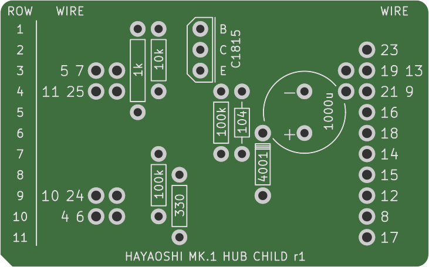
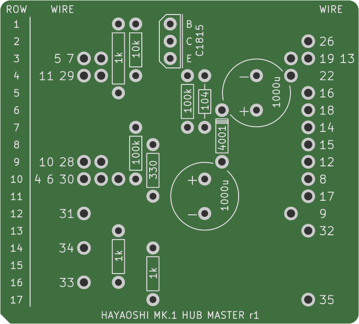
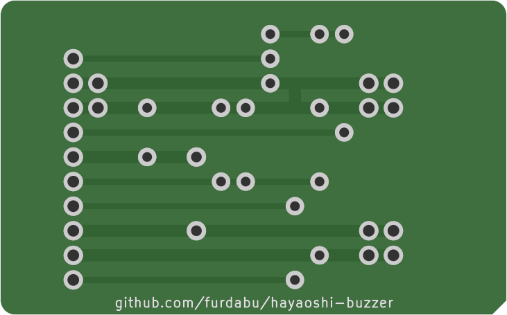
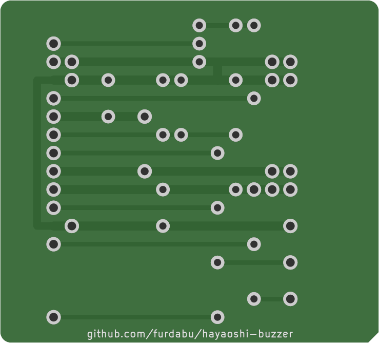

# 中継基板を注文する (プリント基板)

[はんだ付けマニュアル](soldering-guide.md) の **中継基板** は、基板メーカーに注文して作ってもらえます。
注文した基板には、部品の名前・向き・線の番号が印刷されているので、ストリップ基板で手作りするより楽で、まちがえにくくなります。

注文しなくても、ストリップ基板で同じものを作れます。回路・線の番号・手順はどちらも同じです。

> **この基板は初版 (r1) で、まだ実物を作って動かしたことがありません。**
> データは下の「確認していること」のとおり検査していますが、回路そのものを実機で試していない段階です。
> 急がないなら、先にストリップ基板で 1 セット作って動くことを確かめてから注文すると安心です。
> 先に注文する場合は、届いた基板で **まず 1 台だけ** 組み立てて確かめてください。

## 注文するデータ

| | ファイル (そのままアップロードする) | 大きさ | 必要な枚数 |
| --- | --- | --- | --- |
| 子機用 | [`hardware/pcb/hayaoshi-hub-child-r1.zip`](../hardware/pcb/hayaoshi-hub-child-r1.zip) | 52.2 x 32.5mm | 子機 1 台につき 1 枚 |
| 親機用 | [`hardware/pcb/hayaoshi-hub-master-r1.zip`](../hardware/pcb/hayaoshi-hub-master-r1.zip) | 52.8 x 47.7mm | 1 枚 |

子機用と親機用は別の基板なので、**2 種類を別々に注文** します。
多くのメーカーは 5 枚から 5 枚単位の注文です。子機 8 台なら子機用を 10 枚、親機用を 5 枚注文します (あまりが出ます)。

## 基板の見た目

表 (部品をのせる面):

| 子機用 | 親機用 |
| :---: | :---: |
|  |  |

裏 (はんだ付けする面)。配線はすべて裏にあります:

| 子機用 | 親機用 |
| :---: | :---: |
|  |  |

印刷の見方は [はんだ付けマニュアルの 3 章](soldering-guide.md#a-注文した基板を使う) にあります。

## 基板の仕様

注文画面で聞かれたときのための一覧です。ほとんどはアップロードしたデータから自動で読み取られます。

| 項目 | 値 |
| --- | --- |
| 層の数 | 2 (両面) |
| 板の厚さ | 1.6mm |
| 材質 | FR-4 (ふつうのガラスエポキシ) |
| 穴 | すべてめっきあり。直径 1.0 / 1.1 / 1.2mm。子機用 39 個、親機用 51 個 |
| 配線の幅 | 0.6mm (信号) / 1.2mm (電源と GND)。配線は裏面だけ |
| 配線どうしのすき間 | 最小 0.54mm |
| 印刷 (シルク) | 表と裏。線の太さ 0.16mm、文字の高さ 1.0mm 以上 |
| 部品 | すべて足を穴に通すタイプ。表面に貼り付ける部品はない |

細い配線や小さな穴はないので、どのメーカーの標準の仕様でも作れます。

## 注文のしかた (JLCPCB の例)

画面の作りは変わることがあるので、流れだけ書きます。

1. 上の表の zip ファイルを 2 つダウンロードする (**解凍しない**)
2. メーカーのサイトで基板の注文 (見積もり) のページを開き、ガーバーファイルをアップロードする所に **子機用の zip** を入れる
3. 読み込みが終わると、基板の絵と大きさが表示される。**大きさが 52.2 x 32.5mm、層の数が 2** になっていることと、絵が上の「基板の見た目」と同じことを確かめる
4. 枚数を選ぶ (子機 8 台なら 10 枚)。ほかの設定は初期値のままでかまいません
   - 板の厚さ 1.6mm、表面の仕上げは標準 (HASL) で十分です
   - 基板の色は好みで選べます (色によって値段や日数が変わることがあります)
   - 部品の取り付けサービス (PCB Assembly) は **申し込みません**。部品は自分ではんだ付けします
5. カートに入れる
6. **親機用の zip** でも 2〜5 を行う (大きさは 52.8 x 47.7mm、枚数は 5 枚)
7. 送り先と配送方法を選び、支払いをする

- 値段は基板代が 1 種類につき数百円〜、送料を合わせて全部で 1,500〜4,000 円くらいが目安です (2026 年 11 月。配送方法で大きく変わるので、注文画面の見積もりで確かめてください)
- 届くまではおよそ 1〜2 週間です
- メーカーによっては、基板のどこかに小さく注文番号が印刷されます。動作には関係ありません

PCBWay や Elecrow など、ほかのメーカーでも同じ zip で注文できます。

## 届いたら

1. 印刷が読めること、穴がふさがっていないことを見る
2. テスターの導通チェックで、次の 3 つを確かめる (`ROW` の数字が行の番号です)

   | 当てる所 | 正しい結果 |
   | --- | --- |
   | 3 行の穴と 4 行の穴 (親機用は 12 行の穴も) | 鳴る |
   | 9 行の穴と 3 行の穴 | 鳴らない |
   | 10 行の穴と 3 行の穴 | 鳴らない |

3. [はんだ付けマニュアル](soldering-guide.md) の 3 章「A. 注文した基板を使う」から進める。
   **まず 1 台だけ** 組み立てて、マニュアルの「確認」をすべて通ってから残りを作る

## zip の中身

| ファイル | 中身 |
| --- | --- |
| `.GTL` / `.GBL` | 表 / 裏の銅はく (配線は裏) |
| `.GTS` / `.GBS` | 表 / 裏の、はんだ付けする所だけ銅はくを出すための窓 |
| `.GTO` / `.GBO` | 表 / 裏の印刷 |
| `.GKO` | 基板の外形 |
| `-PTH.DRL` | 穴の位置と直径 |

一般的な形式 (ガーバー RS-274X と Excellon) です。同じファイルが `hardware/pcb/hub_child/` と `hardware/pcb/hub_master/` にも入っています。

## 確認していること

基板のデータは `hardware/pcb/make_pcb.py` が、はんだ付けマニュアルと同じ配線データから作っています。
部品の並び・線の番号・行の番号は、ストリップ基板で作る中継基板と同じです。

スクリプトは、書き出したファイルを読み直して次のことを調べ、問題があればエラーで止まります。

- 銅はくのつながりが、期待する回路と同じ (子機用 10 組、親機用 14 組)
- 別の配線どうしが 0.3mm 以上はなれている (実際は最小 0.54mm)
- すべての穴に、表と裏のパッドがある。穴のまわりの銅はくが 0.35mm 以上ある
- 銅はくが基板の端から 0.5mm 以上はなれている
- 印刷が、はんだ付けする所に重なっていない。基板からはみ出していない

このほかに、別の読み取りソフトでもファイルを読み込み、銅はくを画像にしてつながりを調べ直して、同じ結果になることを確かめています。

**確認できていないこと**: 実物の基板での動作、メーカーの注文画面での読み込み (アップロードしたときのプレビューを必ず見てください)。

## データを作り直す

配線を変えたときは、`hardware/wiring/make_diagrams.py` のデータを直してから、次を実行します。

```bash
pip install gerbonara
python hardware/pcb/make_pcb.py
```
