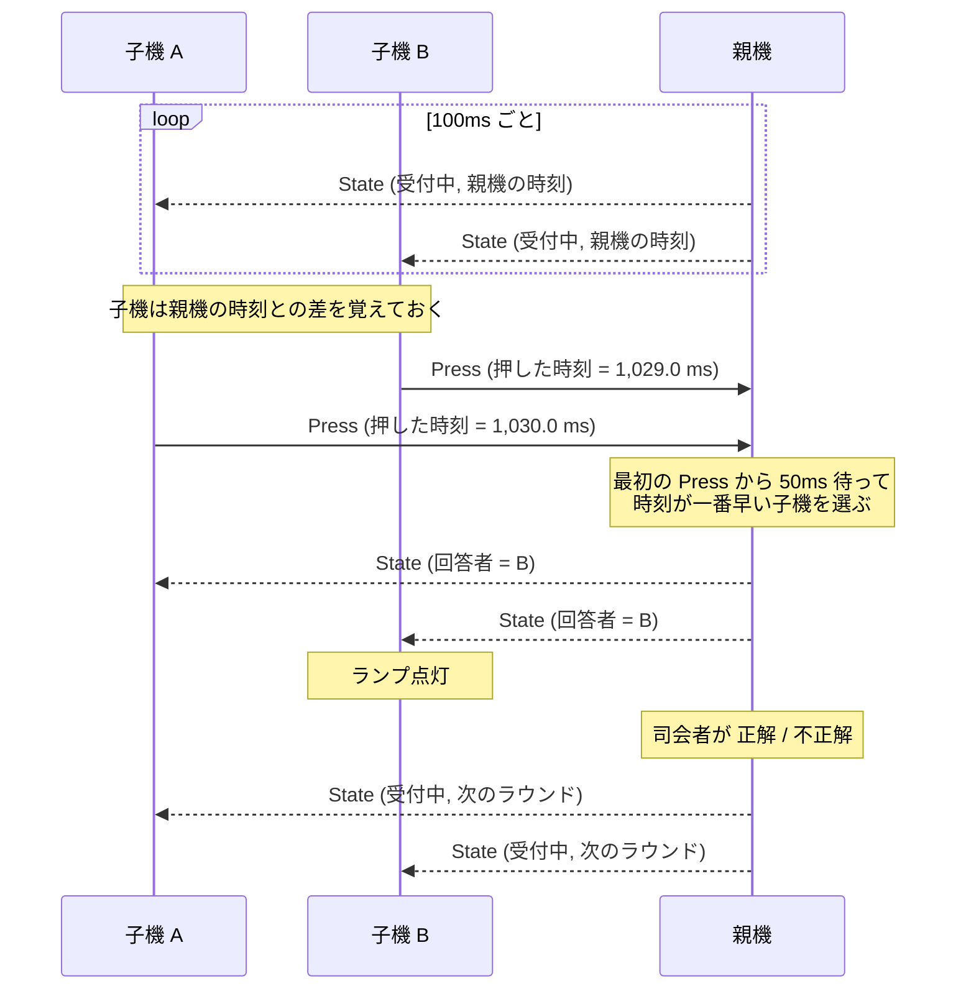

# 通信と判定の仕組み

## 全体



- 無線は ESP-NOW (ESP32 同士が Wi-Fi の電波で直接やりとりする仕組み) を使います。ルーターは不要です
- 親機 → 子機は **一斉送信 (broadcast)**。子機 → 親機は **1 対 1 送信 (unicast)** で、届かなければ自動で再送されます
- ESP-NOW で 1 対 1 送信できる相手は 20 台までなので、親機から子機へは全部一斉送信にしています
  (子機に番号を伝える `Assign` も、宛先の MAC アドレスを中に書いて一斉送信します)

## パケット

定義は [`firmware/include/protocol.h`](../firmware/include/protocol.h) にあります。

| 種類 | 向き | 内容 | タイミング |
| --- | --- | --- | --- |
| `State` | 親機 → 全子機 | 受付中 / 回答者決定, 回答者, ラウンド番号, 親機の時刻, 直前の判定 | 100ms ごと + 状態が変わったら 3 回連続 |
| `Press` | 子機 → 親機 | ラウンド番号, 押した時刻 (親機の時計に換算済み) | 押したとき (決着がつくまで最大 4 回再送) |
| `Hello` | 子機 → 親機 | 自分の番号, 電池電圧 (20mV 単位) | 約 1 秒ごと |
| `Assign` | 親機 → 全子機 | 宛先の MAC アドレス, 番号 | 番号が変わったとき |

`State` は毎回「今の状態そのもの」を送るので、何回か取りこぼしても次の受信で正しい状態に戻ります。

## 公平な判定のための工夫

### 1. 「届いた順」ではなく「押した時刻」で決める

無線は混雑や再送で数 ms〜数十 ms 遅れることがあります。届いた順に決めると、たまたま電波の条件が悪かった子機が不利になります。
そこで子機は、ボタンが押された瞬間の時刻を **割り込み** で記録し、それを親機の時計に換算して送ります。

親機は最初の `Press` が届いてから `ARBITRATION_WINDOW_MS` (50ms) だけ待ち、その間に届いた中で時刻が一番早い子機を選びます。
50ms はボタンを押してからランプが点くまでの遅れになりますが、人間にはほぼ気になりません。

### 2. 時計合わせ

親機は `State` を送る直前に自分の時刻を書き込みます。同じ一斉送信の電波は全子機にほぼ同時に届くので、各子機は

```
差 = 親機の時刻 − 受信した瞬間の自分の時刻
```

を求めておけば、全員が同じ基準で親機の時計を推定できます。
受信処理の遅れは「差」を小さくする方向にしか働かないため、直近 8 回分の最大値を使って遅れの影響を減らしています
([`clock_sync.h`](../firmware/lib/buzzer_core/src/clock_sync.h))。

この方式での子機どうしの誤差は、受信処理の遅れのばらつき程度 (1ms 未満) になる見込みです。
実機で 64 台を使った測定はまだしていません。測定結果をお持ちの方は Issue で教えてください。

### 3. フライングと押しっぱなし対策

- 受付開始より前かどうかは **親機が自分の時計で判断** し、前の押下は捨てます (時計合わせの誤差として 5ms までは許容)
- 子機は、受付中でないときに押されたボタンも 0.25 秒だけ覚えておき、「受付中」の `State` が届いたら送ります。
  親機がちょうど次のラウンドを始めた瞬間に押した人が、知らせの到着が遅れたせいで不利にならないようにするためです
- 押しっぱなしのボタンは押下として数えません (一度離してから押し直す必要があります)
- 1 ラウンドで送れる押下は 1 回だけです

### 4. 負けた子機が光らない

子機は自分でランプを点けず、親機から「あなたが回答者」という `State` が届いたときだけ点灯します。
そのため、ほぼ同時に押した子機が一瞬だけ光ってしまうことはありません。

## 番号の管理

親機は子機の MAC アドレスと番号の対応表をフラッシュ (NVS) に保存しています。
未登録の子機から `Hello` が届くと、空いている一番小さい番号ではなく **次の番号** を割り当てます (番号の付け直しは番号登録モードで)。

## 複数セットを同じ場所で使う

`GROUP_ID` が違うパケットは無視されるので、セットごとに `GROUP_ID` を変えれば混信しません。
電波が混んでいる場合は `WIFI_CHANNEL` もセットごとに 1 / 6 / 11 などに分けると安定します。
