# はんだ付けマニュアル (配線の手順書)

この手順書では、「どの部品の、どの端子を、どこにつなぐか」を、線 1 本ずつ番号を付けて説明します。
作業は **はんだ付け** です。難しい技術は使わず、同じ作業のくり返しで完成します。

- 回路の考え方は [配線図のページ](wiring.md) に、ケースへの取り付け方は [組み立てのページ](assembly.md) に書いてあります
- 図は小さく表示されます。**図をクリックすると大きく開きます**

## 作り方の全体像

抵抗などの細かい部品は、**中継基板** という小さな基板 1 枚にまとめます。
ほかの部品 (電池・マイコン・ボタンなど) は、**線で中継基板につなぐだけ** です。

| | 中継基板 | はんだ付けする線 |
| --- | --- | ---: |
| 子機 1 台 | 1 枚 | 25 本 |
| 親機 | 1 枚 | 41 本 |

中継基板は、**基板メーカーに注文した専用の基板** を使う方法と、**市販のストリップ基板で手作り** する方法があります。
どちらを選んでも、線の番号と手順は同じです ([3 章](#3-中継基板を用意する))。

進め方は子機も親機も同じです。

1. 中継基板を用意する ([3 章](#3-中継基板を用意する))
2. 線を番号順に、ステップごとにはんだ付けする (子機は [4 章](#4-子機の配線)、親機は [5 章](#5-親機の配線))
3. 途中の「確認」でテスターを当てて、まちがいを早めに見つける

図の見方:

- **丸の数字** = 線の番号。図と表で同じ番号です
- **四角の数字** = 中継基板の行の番号
- 図の箱は部品、箱の中の文字は **部品に印刷されている端子の名前** です

**まず子機を 1 台だけ作って、親機と組み合わせて動くことを確かめてから** 残りを作るのがおすすめです。

## 1. 用意するもの

### 道具

| 道具 | メモ |
| --- | --- |
| はんだごて | 30〜60W。温度を変えられるものなら 330〜350℃ |
| こて台とスポンジ | こて先の汚れをふき取る |
| はんだ | ヤニ入り、太さ 0.6〜0.8mm |
| ニッパー | 線や部品の足を切る |
| ワイヤーストリッパー | 線の被覆をむく (AWG 24〜26 に合うもの) |
| ピンセットかラジオペンチ | 部品の足を曲げる |
| テスター | 電圧と導通 (つながっているか) を確かめる。**必須** |
| 油性ペン | MT3608 に印を付ける。ストリップ基板で作るときは、行の番号も書く |
| あると便利 | はんだ吸い取り線、基板をはさむクリップ台、マスキングテープ |

### 材料 (部品表の部品のほかに)

| 材料 | 量 | メモ |
| --- | --- | --- |
| 中継基板 | 子機 1 台につき 1 枚、親機に 1 枚 | 次のどちらか。ちがいは [3 章](#3-中継基板を用意する) にあります<br>**A. 注文した基板** ([注文のしかた](pcb-order.md))<br>**B. ストリップ基板** を切ったもの (下の行) |
| ストリップ基板 (2.54mm ピッチ)。**B の場合だけ** | 子機 1 台につき 14 穴 x 11 行、親機は 14 穴 x 17 行 | 「ストリップボード」「Veroboard」の名前で売っている、**裏の銅はくが 1 列ずつ帯になっている基板**。65 x 145mm のものなら、子機 8 台 + 親機 1 台分で 2〜3 枚使う (帯が長い辺にそっていれば 2 枚、短い辺にそっていれば 3 枚) |
| 電線 (AWG 24〜26) | 子機 1 台で約 3.5m、親機で約 6m | 赤・黒と、ほかに 2〜3 色あると見分けやすい |
| 熱収縮チューブ (直径 2〜3mm) | 少し | ピンにはんだ付けした所にかぶせる。ビニールテープでもよい |

## 2. はじめに読むこと

### 安全のための約束

1. **はんだ付けをするときは、電池を電池ボックスから外す。** 18650 電池は、+ と − が直接つながる (ショートする) と大きな電流が流れて危険です
2. **電池を入れるときは、+ − の向きを電池ボックスの表示に合わせる。** 逆に入れると充電モジュールがこわれることがあります
3. **MT3608 は、出力をほかの部品につなぐ前に電圧を合わせる。** 買ったままだと高い電圧が出ていて、つないだ部品をこわします (手順の中で合わせます)
4. **向きのある部品は、付ける前に向きを 2 回確かめる。** 特に電解コンデンサは、逆に付けると破裂します
5. こて先は 300℃ 以上あります。使わないときは必ずこて台に置き、作業が終わったら電源を抜きます

### はんだ付けのこつ

1. こて先を、**部品の足と基板の銅はくの両方** に 2 秒当てて温める
2. こて先ではなく、**温めた所** にはんだを当てて溶かす
3. はんだが富士山の形に広がったら、はんだを離し、次にこてを離す
4. つやのある山の形なら成功。玉のように丸まっていたら、もう一度こてを当てて温め直す

線をつなぐときは、先に **予備はんだ** をすると楽です。
線の先を 4〜5mm むき、指でねじってから、はんだを少ししみこませておきます。

### 向きのある部品

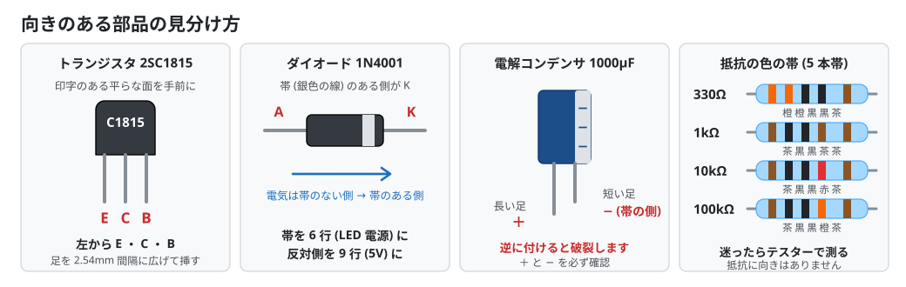

抵抗の色の帯が 4 本のものは、次の色です (最後の金色は精度を表します)。

| 抵抗 | 5 本帯 | 4 本帯 |
| --- | --- | --- |
| 330Ω | 橙 橙 黒 黒 茶 | 橙 橙 茶 金 |
| 1kΩ | 茶 黒 黒 茶 茶 | 茶 黒 赤 金 |
| 10kΩ | 茶 黒 黒 赤 茶 | 茶 黒 橙 金 |
| 100kΩ | 茶 黒 黒 橙 茶 | 茶 黒 黄 金 |

> トランジスタの足の並びは品種によって違います。この手順書は **2SC1815** 用です。
> ほかの品種 (2N2222 など) を使うときは、足の並びを調べて E・C・B が合うように挿してください。

### 端子の見分け方

| 部品 | 端子 | 見分け方 |
| --- | --- | --- |
| アーケードボタンのスイッチ | `COM` `NO` `NC` | ボタンの下に付いている黒い小さな箱 (マイクロスイッチ) に刻印がある。`NC` は使わない。刻印が読めないときは、テスターの導通チェックで **ボタンを押したときだけつながる 2 本** を使う |
| アーケードボタンの LED | `+` `−` | ランプの台から出ている 2 本の端子。向きがあり、逆だと光らない (こわれはしない)。光らなければ入れ替える |
| 電源ボタン (子機, Pten) | スイッチ端子 2 本、LED `+` `−` | LED の端子には `+` `−` の印がある。残りの 2 本がスイッチ端子で、どちらにどの線をつないでもよい |
| 電源ボタン (親機, LA16) | `C` `NO` `NC`、LED `+` `−` | 端子の横に刻印がある。`C` と `NO` を使い、`NC` は使わない |
| LED 基板 | `IN` `PWR` `GND` `OUT` | LED のある面に刻印がある。`IN` が `DIN` や `DI`、`PWR` が `5V` や `VCC` と書かれた製品もある。`OUT` は使わない |
| TP4056 | `B+` `B-` `OUT+` `OUT-` | Type-C の反対側の端にある 4 つの穴 |
| MT3608 | `VIN+` `VIN-` `VOUT+` `VOUT-` | 四すみの穴。青い四角い部品の金色のネジが、電圧を合わせるつまみ |

### ピンヘッダーが付いている基板のはんだ付け

親機の ESP32 開発ボード・DFPlayer・TM1637 は、金属のピンが並んで付いています。線はピンに直接はんだ付けします。

1. 線に熱収縮チューブ (1cm) を通しておく
2. 予備はんだをした線を、ピンの横にそわせる
3. こてを当てて、線とピンをはんだでくっつける
4. 冷めたら熱収縮チューブをピンの根元までずらし、こての熱 (こての軸を近づける) かドライヤーで縮める

子機の ESP32-C3 SuperMini は、ピンヘッダーを付けずに使います。
線の先を部品のある面から穴に通し、裏ではんだ付けして、はみ出た線を切ります。

## 3. 中継基板を用意する

中継基板は、**横 1 列 (同じ行) の穴が裏でつながっている** 基板です。
同じ行に足を挿した部品と線は、それだけでつながります。

作り方は 2 つあります。**どちらで作っても、4 章からの配線 (線の番号と行の番号) はまったく同じです。**

| | A. 注文した基板 (プリント基板) | B. ストリップ基板で手作り |
| --- | --- | --- |
| どんなもの | 基板メーカーに注文して作ってもらう、この機械専用の緑色の基板 | 市販のストリップ基板を切って作る |
| 作業 | 印刷のとおりに部品を挿して、はんだ付けするだけ | 基板を切り、行の番号を書き、穴を数えて部品を挿す |
| まちがえにくさ | 部品の名前・向き・線の番号が基板に印刷されている | 図を見ながら穴を数える |
| 始められる時期 | 注文してから届くまで 1〜2 週間 | 基板があればすぐ |
| 大きさ (子機用 / 親機用) | 約 52 x 33mm / 約 53 x 48mm | 約 38 x 30mm / 約 38 x 46mm |

### A. 注文した基板を使う

注文のしかたは [中継基板を注文する](pcb-order.md) のページにあります。届いた基板は次のような見た目です。

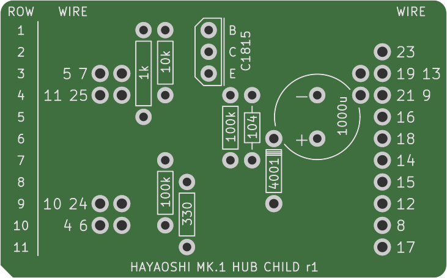

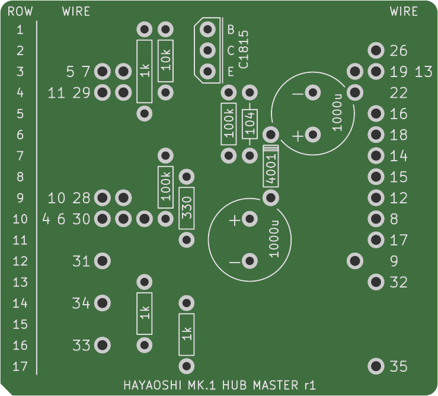

基板の印刷の見方:

| 印刷 | 意味 |
| --- | --- |
| 左はしの `ROW` の列の数字 | **行の番号** (この手順書の「10 行」など) |
| `WIRE` の列の数字 | **線の番号**。その行の、その側の穴にはんだ付けする (穴が 2〜3 個ならんでいる所は、どの穴でも同じ) |
| 四角い枠と `1k` `10k` `100k` `330` | 抵抗 (1kΩ・10kΩ・100kΩ・330Ω) |
| `4001` | ダイオード 1N4001。**3 本線のある側に、ダイオードの帯** を合わせる |
| `104` | セラミックコンデンサ 0.1µF |
| 丸い枠と `1000u` | 電解コンデンサ 1000µF。**`+` の印の穴に長い足** を挿す |
| `B` `C` `E` と `C1815` | トランジスタ 2SC1815。**二重線のある側に、印字のある平らな面** を向ける |

部品のはんだ付け:

1. 部品は **印刷のある面** から足を挿し、裏ではんだ付けして、余った足をニッパーで切る
2. [部品の一覧](#部品の一覧) の順 (背の低い部品から) に付ける。**ジャンパーはいりません** (基板の中でつながっています)
3. `WIRE` の番号がある穴は、あとで線をはんだ付けする穴です。**ここにはまだ何も付けません**

### B. ストリップ基板で作る

#### 基板を切る

1. ストリップ基板を、**銅はくの帯が横向き** になるように置く
2. 子機用は **14 穴 x 11 行** (約 38 x 30mm)、親機用は **14 穴 x 17 行** (約 38 x 46mm) の大きさに切る。
   **14 穴が帯の向き** (1 本の帯に穴が 14 個) になるようにする。
   切る位置の穴の列にカッターで両面から何度も筋を入れ、机の角に当てて折る (切った列の穴はなくなるので、1 列余分に数える)
3. 切り口をやすりで軽くこすり、となりの帯とつながる銅のくずを落とす
4. 部品をのせる面 (銅はくのない面) の左はしに、油性ペンで上から行の番号 1、2、3… を書く

#### 部品をはんだ付けする

部品は **銅はくのない面** から足を挿し、裏の銅はくにはんだ付けして、余った足をニッパーで切ります。
[部品の一覧](#部品の一覧) の順 (背の低い部品から) に付けると、基板を裏返したときに部品が落ちにくくなります。
ジャンパーは、先に付けた抵抗の足を切った残りで作ります。

穴の場所は「列のアルファベット + 行の番号」で表します。たとえば `c5` は、左から 3 列目・上から 5 行目の穴です。

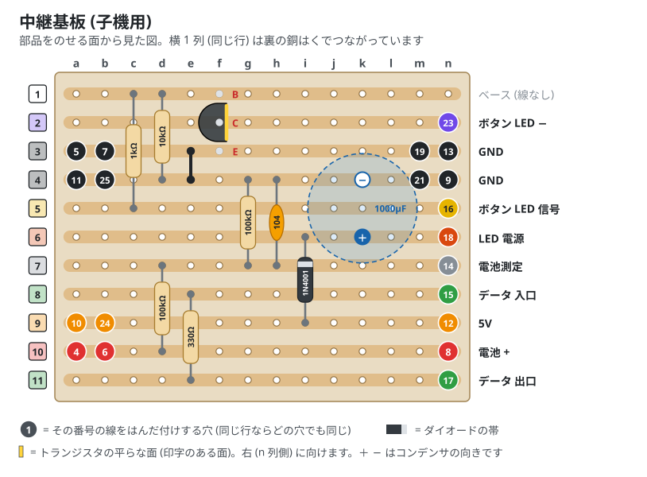

親機用は、子機用の下に 6 行足して、部品を 4 つ増やしたものです。1〜11 行の部品は子機用と同じです。

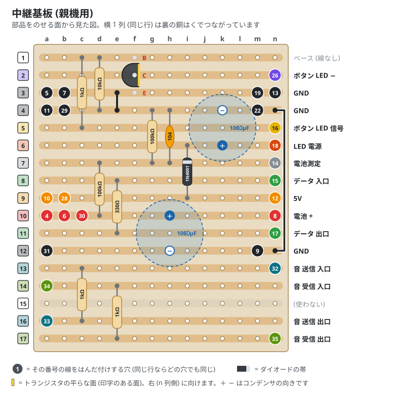

- 図のトランジスタの **黄色い線が、印字のある平らな面** です。平らな面を右 (n 列側) に向けます
- 図の色つきの丸は、あとで線をはんだ付けする穴です。**ここにはまだ何も付けません**

#### 普通のユニバーサル基板を使う場合

穴ごとに銅はくが分かれている基板では、同じ行の穴がつながっていません。
部品を挿したあと、**行ごとに、使っている穴どうしを裏でつなぎます**。

- となりの穴なら、部品の足を切る前に横へ倒して、となりの足と一緒にはんだ付けする
- 離れた穴は、スズメッキ線 (直径 0.5mm くらいの裸の線) を行にそって置き、使っている穴ごとにはんだ付けする
- 線をはんだ付けする穴 (図の色つきの丸) まで、スズメッキ線をのばしておく

### 部品の一覧

A・B のどちらでも、付ける部品と順番は同じです (ジャンパーだけは B のときにだけ付けます)。

<!-- AUTO:board-parts -->
| 順 | 部品 | 注文した基板の印刷 | ストリップ基板の穴 | 向き・注意 | 使う機種 |
| :---: | --- | :---: | --- | --- | :---: |
| 1 | 抵抗 1kΩ | `1k` | `c1` と `c5` | 向きなし | 両方 |
| 2 | 抵抗 10kΩ | `10k` | `d1` と `d4` | 向きなし | 両方 |
| 3 | 抵抗 100kΩ | `100k` | `g4` と `g7` | 向きなし | 両方 |
| 4 | 抵抗 100kΩ | `100k` | `d7` と `d10` | 向きなし | 両方 |
| 5 | 抵抗 330Ω | `330` | `e8` と `e11` | 向きなし | 両方 |
| 6 | 抵抗 1kΩ | `1k` | `c13` と `c16` | 向きなし | 親機だけ |
| 7 | 抵抗 1kΩ | `1k` | `e14` と `e17` | 向きなし | 親機だけ |
| 8 | ジャンパー (切り落とした抵抗の足で作る) | (いらない) | `e3` と `e4` | **ストリップ基板だけ。** コの字に曲げて挿す | 両方 |
| 9 | ジャンパー線 (被覆つきの電線 約 4cm) | (いらない) | `n4` と `n12` | **ストリップ基板だけ。** ほかの線のじゃまにならないよう基板の端を通す | 親機だけ |
| 10 | ダイオード 1N4001 | `4001` | `i6` と `i9` | **帯のある側を 6 行へ** (注文した基板では、3 本線が印刷されている側) | 両方 |
| 11 | セラミックコンデンサ 0.1µF (印字 104) | `104` | `h4` と `h7` | 向きなし。足を少し広げて挿す | 両方 |
| 12 | トランジスタ 2SC1815 | `C1815` | `f1` (B) ・ `f2` (C) ・ `f3` (E) | **印字のある平らな面を右 (n 列側) へ** (注文した基板では、二重線が印刷されている側)。足を広げて 3 つの穴に | 両方 |
| 13 | 電解コンデンサ 1000µF | `1000u` | `k4` と `k6` | **長い足 (＋) を 6 行、帯のある側 (−) を 4 行へ** (注文した基板では、＋ の印がある穴に長い足) | 両方 |
| 14 | 電解コンデンサ 1000µF | `1000u` | `h10` と `h12` | **長い足 (＋) を 10 行、帯のある側 (−) を 12 行へ** (注文した基板では、＋ の印がある穴に長い足) | 親機だけ |
<!-- /AUTO -->

- 抵抗とダイオードの足は、挿す 2 つの穴の間隔に合わせて直角に曲げます。穴が 3 つ分はなれている所 (7.6mm) は、**胴体のすぐ横** で曲げるとちょうど合います
- 電解コンデンサは **直径 10mm 以下** のものを使います (10V 1000µF なら 8〜10mm)。大きくてとなりの部品に当たるときは、足を長めに残して少し倒してかまいません

### 行の役割

| 行 | 呼び名 | つながるもの |
| :---: | --- | --- |
| 1 | ベース | トランジスタの B。線はつながない |
| 2 | ボタン LED − | アーケードボタンの LED の − |
| 3・4 | GND | すべての部品のマイナス側。3 行と 4 行はつながっている |
| 5 | ボタン LED 信号 | マイコンからの「ボタンを光らせる」信号 |
| 6 | LED 電源 | ランプの LED 基板の電源 (5V からダイオードを通したもの) |
| 7 | 電池測定 | 電池の電圧を半分にしてマイコンへ送る |
| 8 / 11 | データ 入口 / 出口 | ランプの色を決める信号。間に 330Ω が入る |
| 9 | 5V | MT3608 (5V 用) が作った 5V |
| 10 | 電池 + | 電源ボタンを通ったあとの電池のプラス |
| 12 | GND (親機だけ) | 4 行とつながっている |
| 13 / 16 | 音 送信 入口 / 出口 (親機だけ) | マイコン → DFPlayer の信号。間に 1kΩ が入る |
| 14 / 17 | 音 受信 入口 / 出口 (親機だけ) | DFPlayer → マイコンの信号。間に 1kΩ が入る |

### 確認 (テスターの導通チェック)

テスターを導通チェック (つながっているとブザーが鳴る) にして、行のはんだ付けした所に当てます。

| 当てる所 | 正しい結果 |
| --- | --- |
| 3 行と 4 行 (親機は 12 行も) | 鳴る |
| となり合う行どうし (1 と 2、2 と 3、4 と 5 … 順番に全部) | 鳴らない。鳴ったら、はんだがとなりの行にはみ出している |
| 9 行 (5V) と 3 行 (GND) | 鳴らない |
| 10 行 (電池 +) と 3 行 (GND) | 鳴らない |

- 電解コンデンサのある行では、当てた瞬間だけ短く鳴ることがあります。すぐ止まれば正常です
- 注文した基板 (A) は行どうしが十分はなれているので、はんだがとなりの穴につながっていないかを目で見て、表の下の 2 つだけ確かめれば十分です

## 4. 子機の配線

### 全体

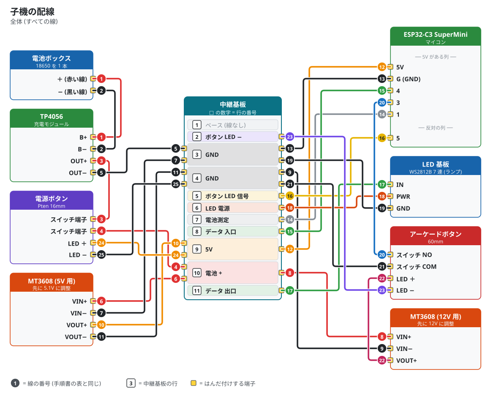

マイコン (ESP32-C3 SuperMini) では、次の 6 か所を使います。

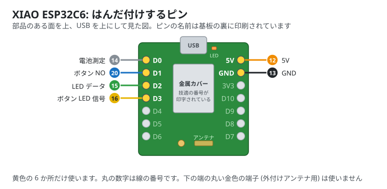

はじめる前に:

- **SuperMini にファームウェアを書き込んでおく** と、途中の確認で動きを見られます ([書き込み方](../README.md#ファームウェアの書き込み))
- ランプの LED 基板とアーケードボタンは天板に付く部品です。天板を開けて横に置けるように、線を長め (20cm) にします
- 線の色は目安です。**赤 = プラス、黒 = GND** だけ守れば、ほかは手持ちの色でかまいません
- 表の「穴」(`a10` など) は、ストリップ基板での場所です。**同じ行なら、空いているどの穴でも同じ** です。
  注文した基板では、`WIRE` の所に **同じ線の番号が印刷されている穴** に挿します
- 「確認」で電池を入れたあとは、**かならず電源ボタンを OFF にして電池を外してから** 次のはんだ付けに進みます

### ステップ 1: 電源の入口 (線 1〜9)

電池 → 充電モジュール → 電源ボタン → 中継基板 → MT3608 の入力、の順に電気が流れるようにします。

> **MT3608 の出力 (`VOUT+` と `VOUT-`) には、まだ何もつなぎません。** 次のステップで電圧を合わせてからつなぎます。

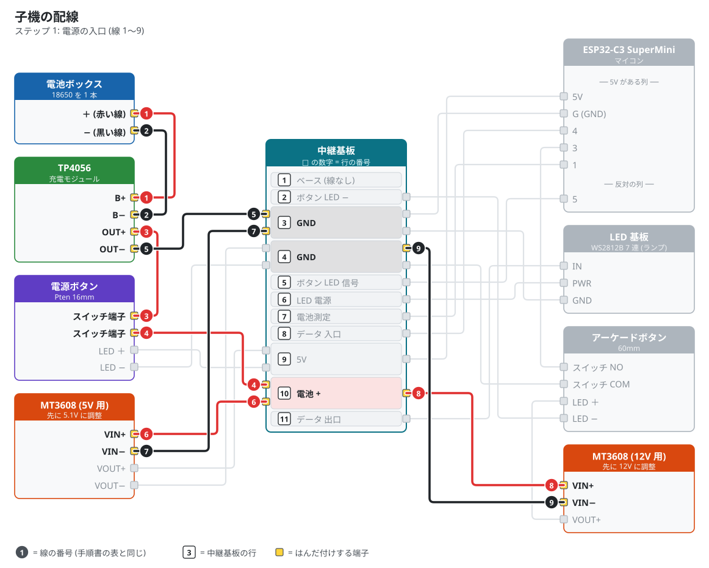

<!-- AUTO:child-step1 -->
| 線 | 色の例 | ここから | ここへ | 長さの目安 |
| :---: | :---: | --- | --- | --- |
| **1** | 赤 | 電池ボックスの **+ (赤い線)** | TP4056 の **B+** | 電池ボックスの線 |
| **2** | 黒 | 電池ボックスの **− (黒い線)** | TP4056 の **B−** | 電池ボックスの線 |
| **3** | 赤 | TP4056 の **OUT+** | 電源ボタンの **スイッチ端子** | 12cm |
| **4** | 赤 | 電源ボタンの **スイッチ端子** | 中継基板 **10 行** (電池 +) の穴 `a10` | 12cm |
| **5** | 黒 | TP4056 の **OUT−** | 中継基板 **3 行** (GND) の穴 `a3` | 12cm |
| **6** | 赤 | 中継基板 **10 行** (電池 +) の穴 `b10` | MT3608 (5V 用) の **VIN+** | 12cm |
| **7** | 黒 | 中継基板 **3 行** (GND) の穴 `b3` | MT3608 (5V 用) の **VIN−** | 12cm |
| **8** | 赤 | 中継基板 **10 行** (電池 +) の穴 `n10` | MT3608 (12V 用) の **VIN+** | 12cm |
| **9** | 黒 | 中継基板 **4 行** (GND) の穴 `n4` | MT3608 (12V 用) の **VIN−** | 12cm |
<!-- /AUTO -->

### ステップ 2: 電圧を合わせて、5V をつなぐ (線 10〜11)

> **線 10・11 は、下の 1〜5 で MT3608 の電圧を合わせ終わってから付けます。**
> 買ったままの MT3608 は高い電圧 (最大 28V くらい) が出ていることがあり、合わせる前につなぐと部品がこわれます。

1. 電源ボタンを OFF にして、電池を入れる (**+ − の向きを電池ボックスの表示に合わせる**)
2. 電源ボタンを ON にして、テスター (直流電圧) で **10 行 (電池 +) と 3 行 (GND)** の間を測る → **3.0〜4.2V** なら正しい
   - 0V のときは、Type-C の充電ケーブルを一度つなぐ (保護回路が働いていて、充電すると解除される)
3. **MT3608 (5V 用)** の `VOUT+` と `VOUT-` にテスターを当て、金色のネジを小さなドライバーで回して **5.1V** に合わせる
   - ネジは 20 回転以上回ります。回しても変わらないときは、変わり始めるまで同じ向きに回し続けます
4. **MT3608 (12V 用)** も同じようにして **12.0V** に合わせる。取りちがえないように、油性ペンで「12」と書いておく
5. 電源ボタンを OFF にして、**電池を外す**
6. **線 10・11** をはんだ付けする

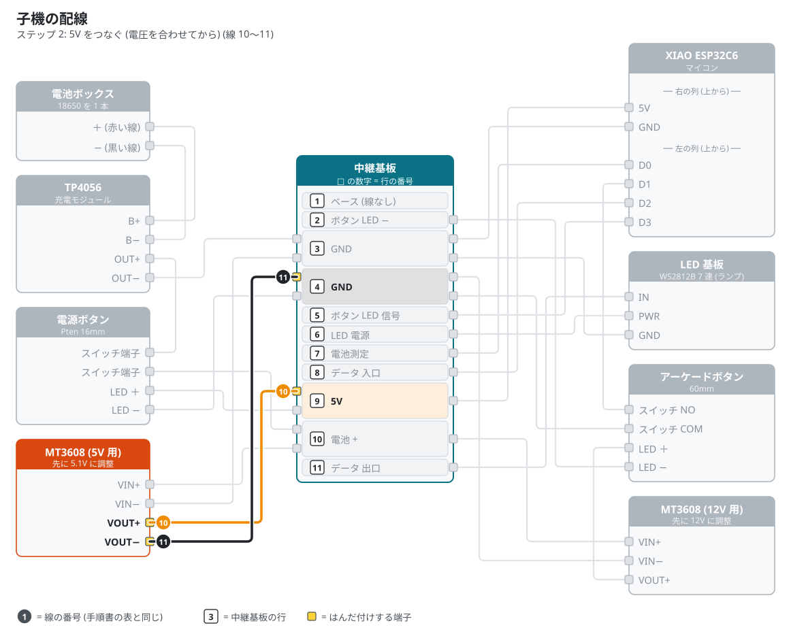

<!-- AUTO:child-step2 -->
| 線 | 色の例 | ここから | ここへ | 長さの目安 |
| :---: | :---: | --- | --- | --- |
| **10** | 橙 | MT3608 (5V 用) の **VOUT+** | 中継基板 **9 行** (5V) の穴 `a9` | 12cm |
| **11** | 黒 | MT3608 (5V 用) の **VOUT−** | 中継基板 **4 行** (GND) の穴 `a4` | 12cm |
<!-- /AUTO -->

**確認**: 電池を入れて ON にし、次の電圧を測ります。**測ったら OFF にして電池を外します。**

| 測る所 | 正しい値 |
| --- | --- |
| 9 行 (5V) と 3 行 (GND) | 5.0〜5.2V |
| 6 行 (LED 電源) と 3 行 (GND) | 9 行より 0.2〜0.8V 低い (4.2〜5.0V くらい。ダイオードを通るので少し下がる) |

### ステップ 3: マイコン (線 12〜16)

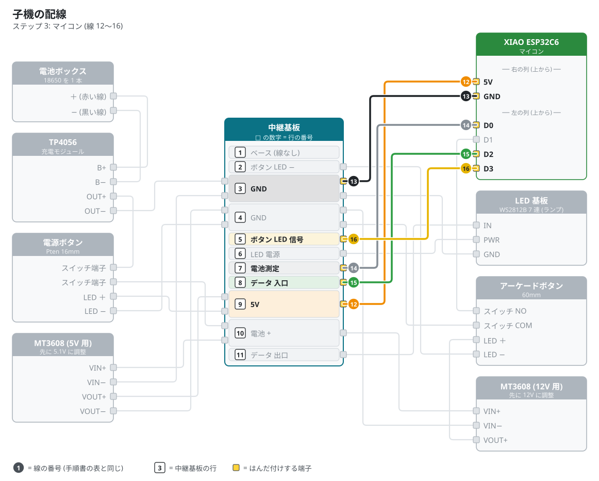

<!-- AUTO:child-step3 -->
| 線 | 色の例 | ここから | ここへ | 長さの目安 |
| :---: | :---: | --- | --- | --- |
| **12** | 橙 | 中継基板 **9 行** (5V) の穴 `n9` | SuperMini の **5V** | 12cm |
| **13** | 黒 | 中継基板 **3 行** (GND) の穴 `n3` | SuperMini の **G (GND)** | 12cm |
| **14** | 灰 | SuperMini の **1** | 中継基板 **7 行** (電池測定) の穴 `n7` | 12cm |
| **15** | 緑 | SuperMini の **4** | 中継基板 **8 行** (データ 入口) の穴 `n8` | 12cm |
| **16** | 黄 | SuperMini の **5** | 中継基板 **5 行** (ボタン LED 信号) の穴 `n5` | 12cm |
<!-- /AUTO -->

- SuperMini の穴は小さく、となりとの間がせまいので、はんだは少なめに。付けたあと、となりの穴とつながっていないか目で確かめます
- **確認**: 電池を入れて ON にすると、SuperMini の上の青い LED が点滅します (親機がないので「未接続」の点滅)。確かめたら OFF にして電池を外します

### ステップ 4: ランプ (線 17〜19)

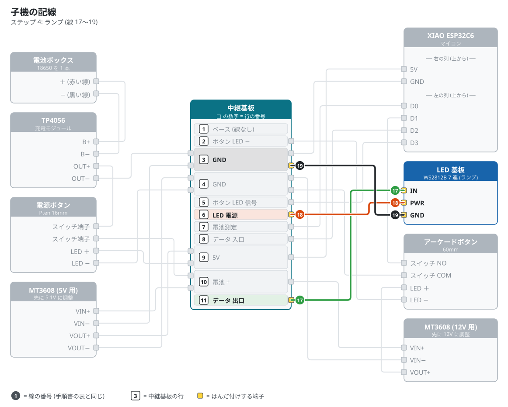

<!-- AUTO:child-step4 -->
| 線 | 色の例 | ここから | ここへ | 長さの目安 |
| :---: | :---: | --- | --- | --- |
| **17** | 緑 | 中継基板 **11 行** (データ 出口) の穴 `n11` | LED 基板の **IN** | 20cm |
| **18** | 橙 | 中継基板 **6 行** (LED 電源) の穴 `n6` | LED 基板の **PWR** | 20cm |
| **19** | 黒 | 中継基板 **3 行** (GND) の穴 `m3` | LED 基板の **GND** | 20cm |
<!-- /AUTO -->

- LED 基板の端子は LED のある面にあります。線は基板のふちを回して裏へ出します
- **確認**: 電池を入れて ON にすると、ランプが電池残量の色 (緑・黄・赤のどれか) で一瞬光り、そのあと青く短く点滅します。確かめたら OFF にして電池を外します

### ステップ 5: ボタン (線 20〜23)

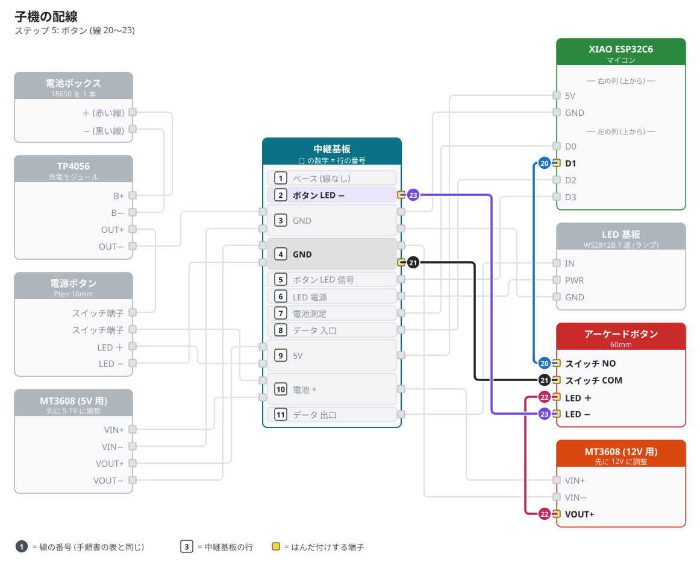

<!-- AUTO:child-step5 -->
| 線 | 色の例 | ここから | ここへ | 長さの目安 |
| :---: | :---: | --- | --- | --- |
| **20** | 青 | SuperMini の **3** | アーケードボタンの **スイッチ NO** | 20cm |
| **21** | 黒 | 中継基板 **4 行** (GND) の穴 `m4` | アーケードボタンの **スイッチ COM** | 20cm |
| **22** | 桃 | MT3608 (12V 用) の **VOUT+** | アーケードボタンの **LED +** | 20cm |
| **23** | 紫 | 中継基板 **2 行** (ボタン LED −) の穴 `n2` | アーケードボタンの **LED −** | 20cm |
<!-- /AUTO -->

- ボタンは先に天板の穴に取り付けてから、はんだ付けすると楽です
- ボタンの LED は、親機とつながって「押せる状態」になったときに光ります。ここではまだ光りません

### ステップ 6: 電源ボタンの LED (線 24〜25)

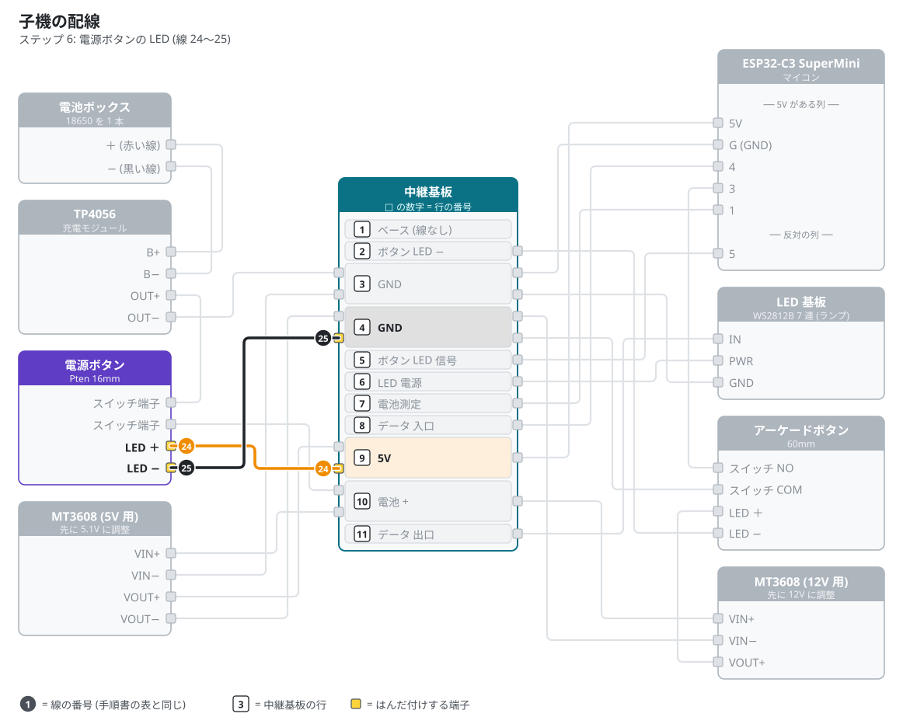

<!-- AUTO:child-step6 -->
| 線 | 色の例 | ここから | ここへ | 長さの目安 |
| :---: | :---: | --- | --- | --- |
| **24** | 橙 | 中継基板 **9 行** (5V) の穴 `b9` | 電源ボタンの **LED +** | 12cm |
| **25** | 黒 | 中継基板 **4 行** (GND) の穴 `b4` | 電源ボタンの **LED −** | 12cm |
<!-- /AUTO -->

- **確認**: 電池を入れて ON にすると、電源ボタンの LED が光ります。確かめたら OFF にして電池を外します

これで子機の配線は終わりです。[6 章](#6-仕上げ) へ進んでください。

## 5. 親機の配線

### 全体

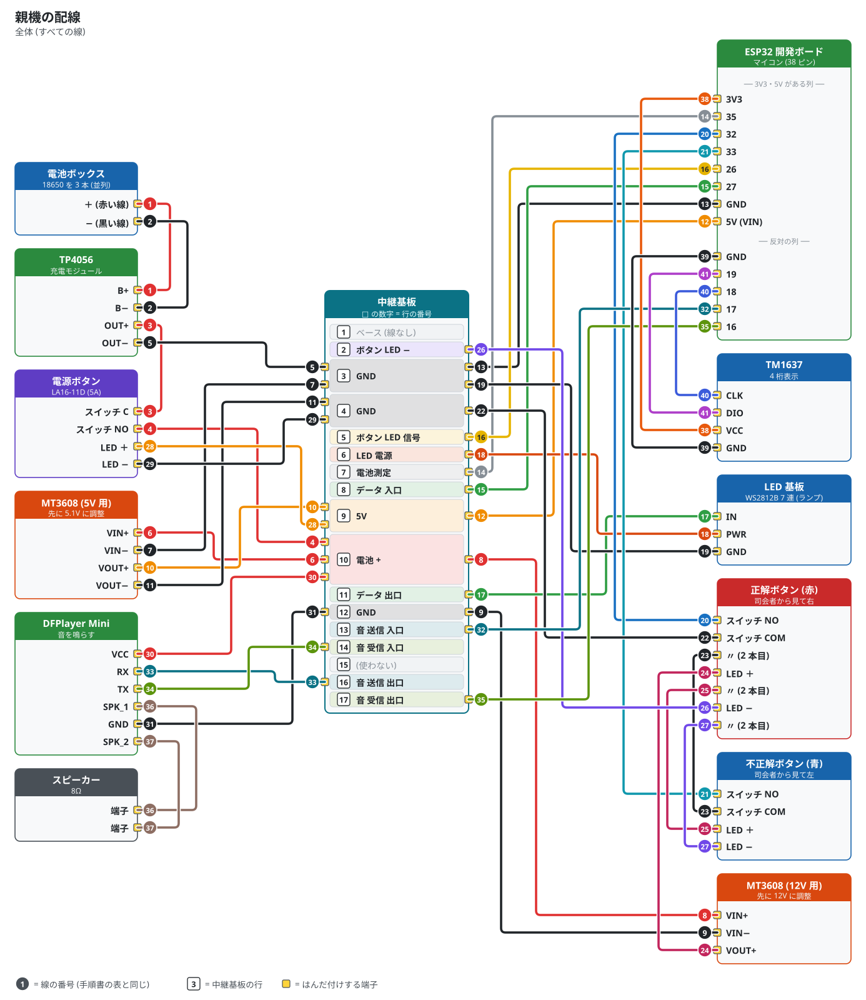

マイコン (ESP32 開発ボード)・DFPlayer・4 桁表示では、次のピンを使います。

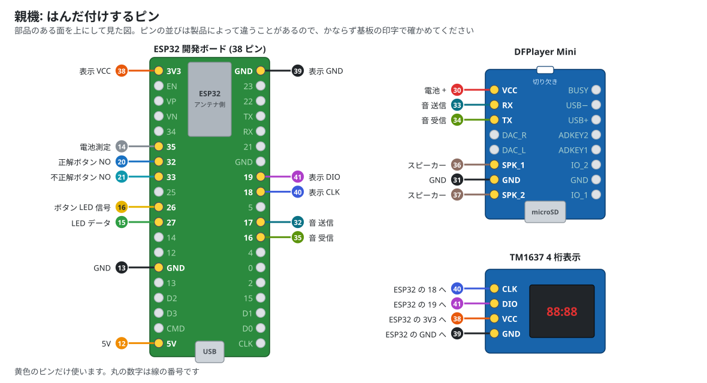

はじめる前に:

- **ESP32 にファームウェアを書き込んでおく** ([書き込み方](../README.md#ファームウェアの書き込み))
- **電池 3 本は、入れる前に 1 本ずつ満充電して電圧をそろえる。** 電圧のちがう電池を並列につなぐと、電池どうしで大きな電流が流れます
- microSD カードに効果音を入れて、DFPlayer に挿しておく ([README](../README.md))
- 中継基板は **親機用 (17 行)** を使います
- 表の「穴」(`a10` など) は、ストリップ基板での場所です。注文した基板では、`WIRE` の所に **同じ線の番号が印刷されている穴** に挿します
- 進め方は子機と同じですが、**線をつなぐ穴や端子の名前がちがう所があります。かならずこの章の表を見てください**
- 「確認」で電池を入れたあとは、**かならず電源ボタンを OFF にして電池を外してから** 次のはんだ付けに進みます

### ステップ 1: 電源の入口 (線 1〜9)

> **MT3608 の出力 (`VOUT+` と `VOUT-`) には、まだ何もつなぎません。** 次のステップで電圧を合わせてからつなぎます。

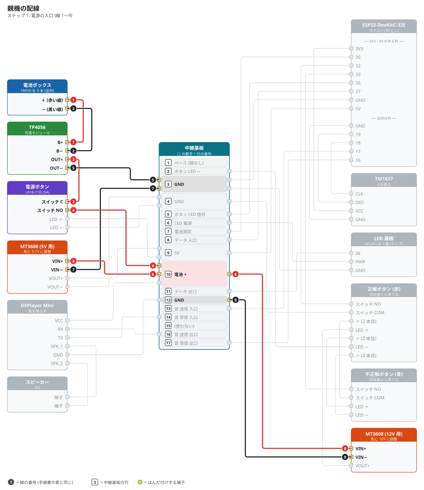

<!-- AUTO:master-step1 -->
| 線 | 色の例 | ここから | ここへ | 長さの目安 |
| :---: | :---: | --- | --- | --- |
| **1** | 赤 | 電池ボックスの **+ (赤い線)** | TP4056 の **B+** | 電池ボックスの線 |
| **2** | 黒 | 電池ボックスの **− (黒い線)** | TP4056 の **B−** | 電池ボックスの線 |
| **3** | 赤 | TP4056 の **OUT+** | 電源ボタンの **スイッチ C** | 12cm |
| **4** | 赤 | 電源ボタンの **スイッチ NO** | 中継基板 **10 行** (電池 +) の穴 `a10` | 12cm |
| **5** | 黒 | TP4056 の **OUT−** | 中継基板 **3 行** (GND) の穴 `a3` | 12cm |
| **6** | 赤 | 中継基板 **10 行** (電池 +) の穴 `b10` | MT3608 (5V 用) の **VIN+** | 12cm |
| **7** | 黒 | 中継基板 **3 行** (GND) の穴 `b3` | MT3608 (5V 用) の **VIN−** | 12cm |
| **8** | 赤 | 中継基板 **10 行** (電池 +) の穴 `n10` | MT3608 (12V 用) の **VIN+** | 12cm |
| **9** | 黒 | 中継基板 **12 行** (GND) の穴 `m12` | MT3608 (12V 用) の **VIN−** | 12cm |
<!-- /AUTO -->

- 親機の電源ボタン (LA16) は端子が 5 本あります。スイッチは `C` と `NO`、LED は `+` と `−` を使い、`NC` には何もつなぎません

### ステップ 2: 電圧を合わせて、5V をつなぐ (線 10〜11)

> **線 10・11 は、下の 1〜5 で MT3608 の電圧を合わせ終わってから付けます。**
> 買ったままの MT3608 は高い電圧 (最大 28V くらい) が出ていることがあり、合わせる前につなぐと部品がこわれます。

1. 電源ボタンを OFF にして、電池を入れる (**+ − の向きを電池ボックスの表示に合わせる**)
2. 電源ボタンを ON にして、テスター (直流電圧) で **10 行 (電池 +) と 3 行 (GND)** の間を測る → **3.0〜4.2V** なら正しい
   - 0V のときは、Type-C の充電ケーブルを一度つなぐ (保護回路が働いていて、充電すると解除される)
3. **MT3608 (5V 用)** の `VOUT+` と `VOUT-` にテスターを当て、金色のネジを小さなドライバーで回して **5.1V** に合わせる
   - ネジは 20 回転以上回ります。回しても変わらないときは、変わり始めるまで同じ向きに回し続けます
4. **MT3608 (12V 用)** も同じようにして **12.0V** に合わせる。取りちがえないように、油性ペンで「12」と書いておく
5. 電源ボタンを OFF にして、**電池を外す**
6. **線 10・11** をはんだ付けする

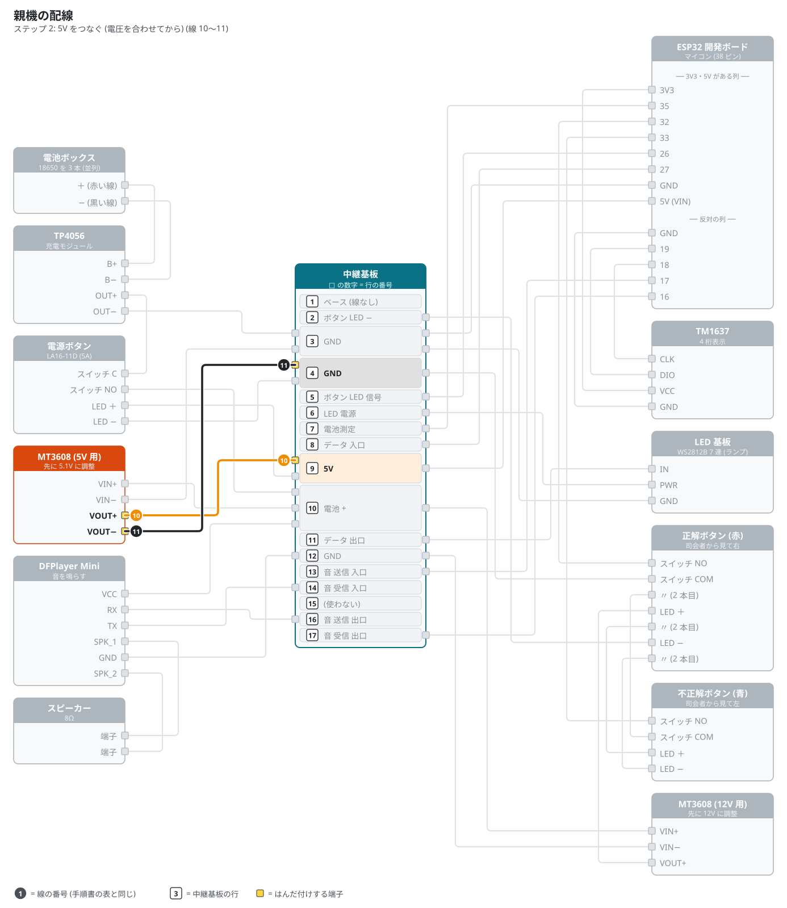

<!-- AUTO:master-step2 -->
| 線 | 色の例 | ここから | ここへ | 長さの目安 |
| :---: | :---: | --- | --- | --- |
| **10** | 橙 | MT3608 (5V 用) の **VOUT+** | 中継基板 **9 行** (5V) の穴 `a9` | 12cm |
| **11** | 黒 | MT3608 (5V 用) の **VOUT−** | 中継基板 **4 行** (GND) の穴 `a4` | 12cm |
<!-- /AUTO -->

**確認**: 電池を入れて ON にし、次の電圧を測ります。**測ったら OFF にして電池を外します。**

| 測る所 | 正しい値 |
| --- | --- |
| 9 行 (5V) と 3 行 (GND) | 5.0〜5.2V |
| 6 行 (LED 電源) と 3 行 (GND) | 9 行より 0.2〜0.8V 低い (4.2〜5.0V くらい。ダイオードを通るので少し下がる) |

### ステップ 3: マイコン (線 12〜16)

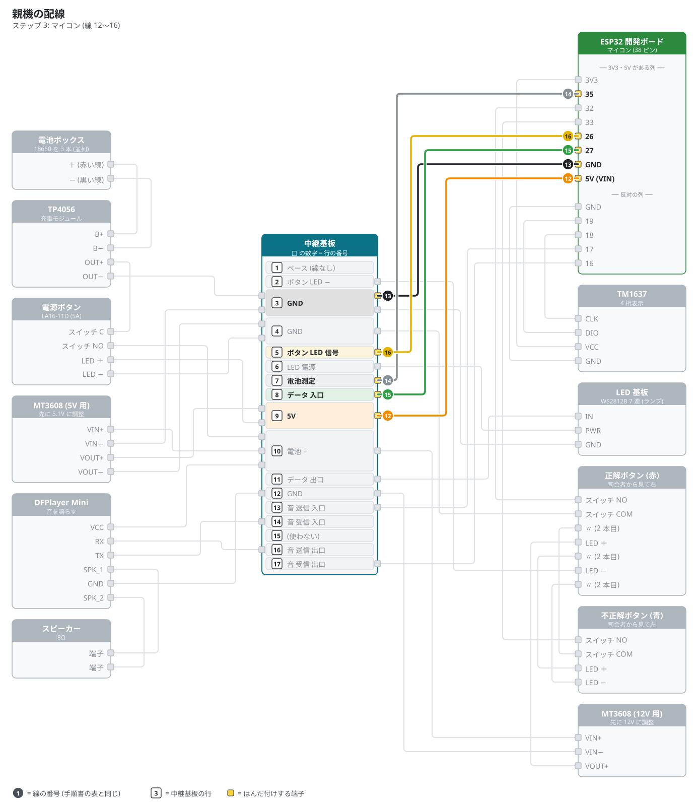

<!-- AUTO:master-step3 -->
| 線 | 色の例 | ここから | ここへ | 長さの目安 |
| :---: | :---: | --- | --- | --- |
| **12** | 橙 | 中継基板 **9 行** (5V) の穴 `n9` | ESP32 の **5V (VIN)** | 12cm |
| **13** | 黒 | 中継基板 **3 行** (GND) の穴 `n3` | ESP32 の **GND** | 12cm |
| **14** | 灰 | ESP32 の **35** | 中継基板 **7 行** (電池測定) の穴 `n7` | 12cm |
| **15** | 緑 | ESP32 の **27** | 中継基板 **8 行** (データ 入口) の穴 `n8` | 12cm |
| **16** | 黄 | ESP32 の **26** | 中継基板 **5 行** (ボタン LED 信号) の穴 `n5` | 12cm |
<!-- /AUTO -->

- ESP32 開発ボードには `GND` のピンが 3 本あります。どれも中でつながっているので、どれを使ってもかまいません
- **確認**: 電池を入れて ON にすると、ESP32 の基板の LED (赤い電源ランプ、または数秒後に点く青いランプ) が光ります。
  LED のない製品では、`5V` ピンと `GND` ピンの間が 5.0〜5.2V なら正しい。確かめたら OFF にして電池を外します

### ステップ 4: ランプ (線 17〜19)

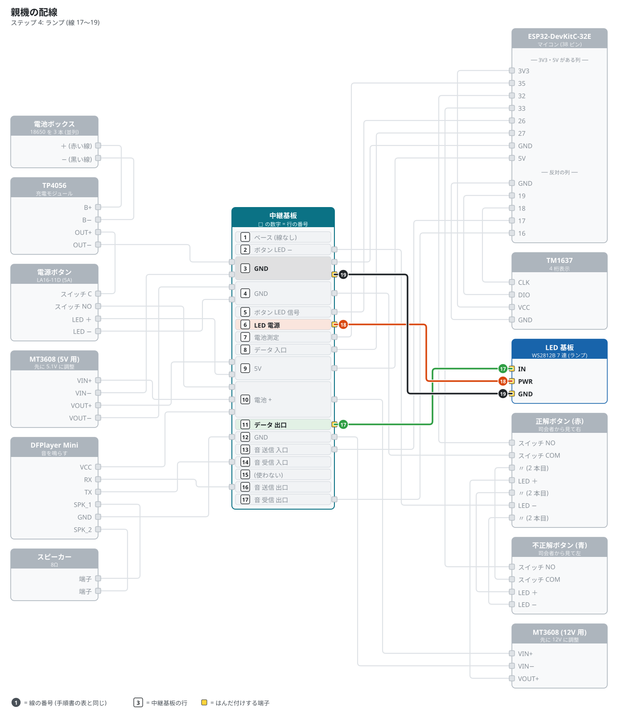

<!-- AUTO:master-step4 -->
| 線 | 色の例 | ここから | ここへ | 長さの目安 |
| :---: | :---: | --- | --- | --- |
| **17** | 緑 | 中継基板 **11 行** (データ 出口) の穴 `n11` | LED 基板の **IN** | 20cm |
| **18** | 橙 | 中継基板 **6 行** (LED 電源) の穴 `n6` | LED 基板の **PWR** | 20cm |
| **19** | 黒 | 中継基板 **3 行** (GND) の穴 `m3` | LED 基板の **GND** | 20cm |
<!-- /AUTO -->

- **確認**: 電池を入れて ON にして数秒待つと、中央のランプが赤 → 青の順に光ります
  (まだ DFPlayer をつないでいないので、光るまで少し時間がかかります)。確かめたら OFF にして電池を外します

### ステップ 5: 正解・不正解ボタン (線 20〜27)

ボタンは 2 個あります。司会者から見て **右が正解 (赤)、左が不正解 (青)** です。
GND と LED の線は、正解ボタンの端子から不正解ボタンの端子へ **渡り線** でつなぎます (線 23・25・27)。
正解ボタンの `COM`・`LED +`・`LED −` には、線が 2 本ずつ付きます。

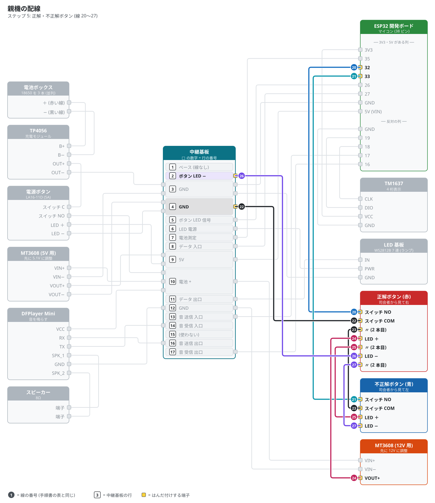

<!-- AUTO:master-step5 -->
| 線 | 色の例 | ここから | ここへ | 長さの目安 |
| :---: | :---: | --- | --- | --- |
| **20** | 青 | ESP32 の **32** | 正解ボタン (赤) の **スイッチ NO** | 20cm |
| **21** | 水色 | ESP32 の **33** | 不正解ボタン (青) の **スイッチ NO** | 20cm |
| **22** | 黒 | 中継基板 **4 行** (GND) の穴 `m4` | 正解ボタン (赤) の **スイッチ COM** | 20cm |
| **23** | 黒 | 正解ボタン (赤) の **スイッチ COM** (2 本目) | 不正解ボタン (青) の **スイッチ COM** | 15cm |
| **24** | 桃 | MT3608 (12V 用) の **VOUT+** | 正解ボタン (赤) の **LED +** | 20cm |
| **25** | 桃 | 正解ボタン (赤) の **LED +** (2 本目) | 不正解ボタン (青) の **LED +** | 15cm |
| **26** | 紫 | 中継基板 **2 行** (ボタン LED −) の穴 `n2` | 正解ボタン (赤) の **LED −** | 20cm |
| **27** | 紫 | 正解ボタン (赤) の **LED −** (2 本目) | 不正解ボタン (青) の **LED −** | 15cm |
<!-- /AUTO -->

- 1 つの端子に 2 本付けるときは、2 本を先にねじり合わせてから端子の穴に通すと、きれいに付きます

### ステップ 6: 電源ボタンの LED (線 28〜29)

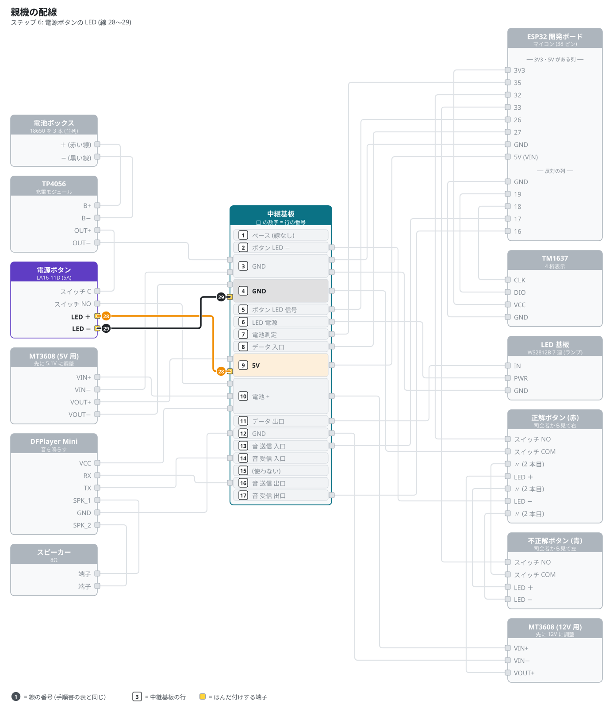

<!-- AUTO:master-step6 -->
| 線 | 色の例 | ここから | ここへ | 長さの目安 |
| :---: | :---: | --- | --- | --- |
| **28** | 橙 | 中継基板 **9 行** (5V) の穴 `b9` | 電源ボタンの **LED +** | 12cm |
| **29** | 黒 | 中継基板 **4 行** (GND) の穴 `b4` | 電源ボタンの **LED −** | 12cm |
<!-- /AUTO -->

### ステップ 7: 音 (線 30〜37)

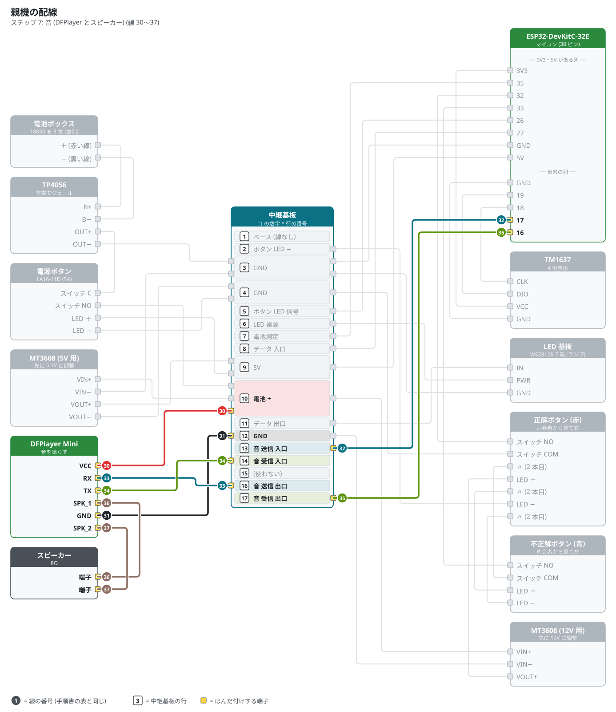

<!-- AUTO:master-step7 -->
| 線 | 色の例 | ここから | ここへ | 長さの目安 |
| :---: | :---: | --- | --- | --- |
| **30** | 赤 | 中継基板 **10 行** (電池 +) の穴 `c10` | DFPlayer Mini の **VCC** | 12cm |
| **31** | 黒 | 中継基板 **12 行** (GND) の穴 `a12` | DFPlayer Mini の **GND** | 12cm |
| **32** | 水色 | ESP32 の **17** | 中継基板 **13 行** (音 送信 入口) の穴 `n13` | 12cm |
| **33** | 水色 | 中継基板 **16 行** (音 送信 出口) の穴 `a16` | DFPlayer Mini の **RX** | 12cm |
| **34** | 黄緑 | DFPlayer Mini の **TX** | 中継基板 **14 行** (音 受信 入口) の穴 `a14` | 12cm |
| **35** | 黄緑 | 中継基板 **17 行** (音 受信 出口) の穴 `n17` | ESP32 の **16** | 12cm |
| **36** | 茶 | DFPlayer Mini の **SPK_1** | スピーカーの **端子** | 12cm |
| **37** | 茶 | DFPlayer Mini の **SPK_2** | スピーカーの **端子** | 12cm |
<!-- /AUTO -->

- DFPlayer の `VCC` は、5V ではなく **10 行 (電池 +)** につなぎます。音を鳴らした瞬間に 5V が下がってマイコンが止まるのを防ぐためです
- DFPlayer の `RX` と `TX` は、**かならず中継基板の 1kΩ を通します** (マイコンのピンに直接つながない)
- スピーカーの 2 本の線は、どちらを `SPK_1`・`SPK_2` につないでもかまいません
- **確認**: 電池を入れて ON にすると、電源ボタンの LED が光り、起動音が鳴ります。確かめたら OFF にして電池を外します

### ステップ 8: 4 桁表示 (線 38〜41)

4 桁表示 (TM1637) は中継基板を通さず、ESP32 に直接つなぎます。

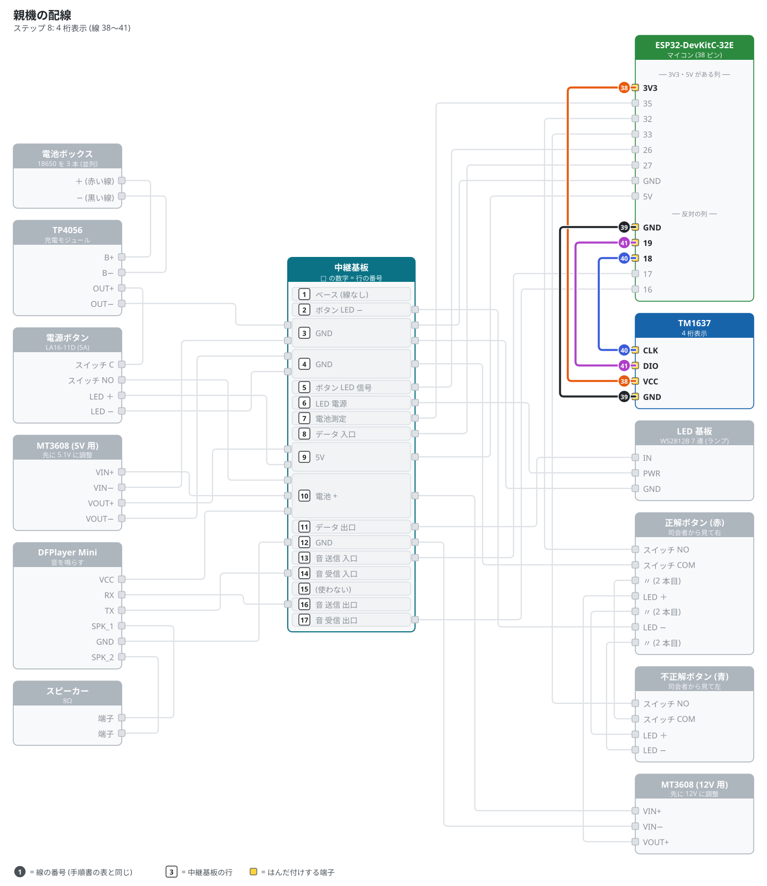

<!-- AUTO:master-step8 -->
| 線 | 色の例 | ここから | ここへ | 長さの目安 |
| :---: | :---: | --- | --- | --- |
| **38** | 橙 | ESP32 の **3V3** | TM1637 の **VCC** | 12cm |
| **39** | 黒 | ESP32 の **GND** | TM1637 の **GND** | 12cm |
| **40** | 青 | ESP32 の **18** | TM1637 の **CLK** | 12cm |
| **41** | 紫 | ESP32 の **19** | TM1637 の **DIO** | 12cm |
<!-- /AUTO -->

- `VCC` は **かならず `3V3`** につなぎます。5V につなぐと、ESP32 のピンに 5V がかかってこわれることがあります
- **確認**: 電池を入れて ON にすると、表示に電池残量 (`b 87` など) が出て、そのあと `c  0` になります。確かめたら OFF にして電池を外します

## 6. 仕上げ

### 見直し

**電池を外した状態で**、もう一度見直します。

- [ ] はんだ付けした所が、となりの端子や行とつながっていない
- [ ] 線のむいた部分が長く出ていて、ほかの金属にさわりそうな所がない (あれば熱収縮チューブかテープで包む)
- [ ] 電解コンデンサ・ダイオード・トランジスタの向きが、図 (注文した基板なら印刷) と同じ
- [ ] テスターの導通チェックで、**10 行 (電池 +) と 3 行 (GND)**、**9 行 (5V) と 3 行 (GND)** が鳴りっぱなしにならない

### ケースに入れる

- 中継基板の裏ははんだの山がとがっていて、金属にさわるとショートします。
  **厚手の両面テープ (スポンジの入ったもの) かホットボンド** で、底から浮かせて固定します
- 置き場所は [組み立てのページの「中の配置」](assembly.md#中の配置) の図を見てください
- 線は結束バンドやマスキングテープで軽くまとめ、ボタンの動く部分にはさまらないようにします

### 動かしてみる

[組み立てのページの「動作確認の順番」](assembly.md#動作確認の順番) のとおりに、親機 → 子機の順で電源を入れて確かめます。
うまく動かないときは [配線図のページの「うまく動かないとき」](wiring.md#うまく動かないとき) を見てください。

## 図と表の直し方

この手順書の図 (`docs/images/wiring/*.svg`) と線の表は、`hardware/wiring/make_diagrams.py` が作っています。
配線を変えるときは、このスクリプトの中のデータを書きかえて実行してください。

```bash
python hardware/wiring/make_diagrams.py
```

スクリプトは図を作る前に、「中継基板と線をたどった接続」が「期待する回路」と同じかを調べます。食いちがっているとエラーで止まります。

注文する基板のデータ (`hardware/pcb/`) は、同じ配線データから `hardware/pcb/make_pcb.py` が作ります ([中継基板を注文する](pcb-order.md))。
配線を変えたら、こちらも実行し直してください。
